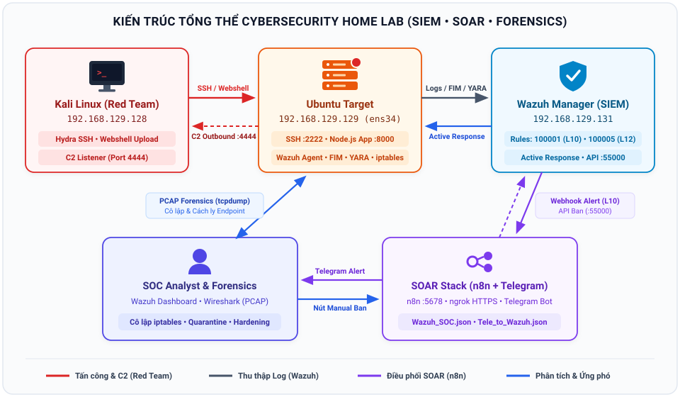

# Cybersecurity Home Lab – SIEM, Detection Engineering & SOAR

Dự án xây dựng môi trường phòng lab an ninh mạng thực chiến theo mô hình **Blue Team / SOC**, mô phỏng trọn vẹn vòng đời giám sát và ứng phó sự cố: từ thu thập log điểm cuối, xây dựng luật phát hiện (**Detection Engineering**), tự động hóa phản ứng (**SOAR**), rà quét mã độc (**YARA**) đến điều tra gói tin mạng (**Network Forensics**) và cô lập đa lớp.

> **Lưu ý:** Toàn bộ kịch bản tấn công và kiểm thử trong kho lưu trữ này chỉ được thực hiện trong mạng Lab cô lập phục vụ mục đích học tập, nghiên cứu và nâng cao năng lực phòng thủ.

---

## 1. Kiến trúc tổng thể Lab

<p align="center">
  
</p>

### Thành phần hạ tầng

| Thành phần | Hệ điều hành / Nền tảng | Địa chỉ IP / Cổng | Vai trò chính |
|---|---|---|---|
| **Attacker / C2** | Kali Linux | `192.168.129.128` (`:4444`) | Mô phỏng tấn công SSH Brute-Force (`Hydra`), tải lên Webshell và đóng vai trò máy chủ C2 |
| **Target Endpoint** | Ubuntu Server | `192.168.129.129` (`ens34`) | Chạy SSH (`:2222`), ứng dụng web Node.js (`:8000`), Wazuh Agent, YARA, `tcpdump` và `iptables` |
| **SIEM Manager** | Wazuh Manager | `192.168.129.131` (`:1514`, `:55000`) | Thu thập log, giải mã, tương quan sự kiện (Custom Rules), điều phối Active Response & API |
| **SOAR Stack** | n8n + ngrok + Telegram Bot | n8n `:5678` + HTTPS Tunnel | Điều phối cảnh báo thời gian thực và thực thi chặn thủ công (Human-in-the-loop) |

---

## 2. Các kịch bản thực chiến đã hoàn thành

| Kịch bản | Trọng tâm kỹ thuật | Custom Rule & MITRE ATT&CK | Tài liệu chi tiết |
|---|---|---|---|
| **01. SSH Brute-Force Detection** | Thu thập `/var/log/auth.log`, phân tích luật mặc định (`5760`) và thiết kế Custom Rule theo tần suất | `Rule 100001` (Level 10) • `T1110.001` | [Xem Kịch bản 01](scenarios/01-ssh-bruteforce/README.md) |
| **02. SOAR: Auto-Ban & Manual Ban** | Tích hợp Wazuh Active Response (`firewall-drop`), n8n, ngrok, Telegram Bot và Wazuh API | `Rule 100001` (Level 10) • Auto & Manual Ban | [Xem Kịch bản 02](scenarios/02-auto-ban/README.md) |
| **03. Webshell & C2 Hunting** | Wazuh FIM + YARA quét mã độc trên Node.js app, bắt gói tin C2 bằng `tcpdump`/Wireshark và cô lập `iptables` | `Rule 100005` (Level 12) • `T1505.003` | [Xem Kịch bản 03](scenarios/03-webshell-c2-hunting/README.md) |

---

## 3. Hiện vật kỹ thuật & Lưu trữ chứng cứ (Artifacts & Evidence)

Toàn bộ luật phát hiện, kịch bản tự động hóa, cấu hình sao lưu và bằng chứng điều tra được phân bổ theo đúng chuẩn quy trình lưu trữ chứng cứ (**Chain of Custody**):

| Danh mục | Tệp tin | Mô tả |
|---|---|---|
| **Wazuh Custom Rules** | [`ssh_bruteforce_rule.xml`](scenarios/01-ssh-bruteforce/detection-rules/ssh_bruteforce_rule.xml) | Custom Rule `100001` phát hiện SSH Brute-Force ($\ge 5$ lần lỗi / 60s) |
| **Wazuh Custom Rules** | [`webshell_detection.xml`](detection-rules/wazuh/webshell_detection.xml) | Custom Decoder `custom-yara-webshell` & Rule `100005` (Level 12) |
| **YARA Rules** | [`webshell_detection.yar`](detection-rules/yara/webshell_detection.yar) | Bộ chữ ký nhận diện hàm thực thi lệnh nguy hiểm trong Webshell PHP/Node.js |
| **Active Response Script** | [`yara_scanner.sh`](scripts/wazuh/yara_scanner.sh) | Script tích hợp Wazuh FIM tự động gọi YARA quét tệp mới tải lên |
| **Cấu hình Agent** | [`ossec.conf`](configs/wazuh/ossec.conf) | Bản sao cấu hình Wazuh Agent trên Ubuntu Target (FIM thời gian thực) |
| **Bằng chứng mạng (PCAP)** | [`c2_traffic.pcap`](evidence/07-integrated-scenarios/c2_traffic.pcap) | Gói tin bắt giữ luồng kết nối Outbound và TCP Stream tới máy chủ C2 |
| **Bằng chứng mã độc (Hash)** | [`malware_hash.txt`](evidence/07-integrated-scenarios/malware_hash.txt) | Báo cáo mã băm MD5 và SHA-256 của tệp Webshell đã cách ly |
| **Ứng dụng mục tiêu** | [`employee-management`](targets/employee-management/Readme.md) | Ứng dụng web Node.js/Express dùng làm máy chủ nạn nhân thực tế |
| **Báo cáo dự án** | [`baseline-report.pdf`](reports/final-report/baseline-report.pdf) • [`baseline-progress-report.docx`](reports/technical-report/baseline-progress-report.docx) | Báo cáo tổng kết và tiến độ kỹ thuật của hệ thống Lab |

---

## 4. Cấu trúc kho lưu trữ

```text
cybersecurity-home-lab/
├── configs/                # Sao lưu cấu hình hệ thống (Wazuh, SSH, UFW, Suricata...)
├── detection-rules/        # Bộ luật phát hiện tập trung (Wazuh XML, YARA, Suricata)
├── docs/                   # Tài liệu kiến trúc (architecture/), hướng dẫn và khắc phục
├── evidence/               # Lưu trữ chứng cứ điều tra theo từng mảng (PCAP, Hash...)
├── labs/                   # Khung bài thực hành nền tảng (Network, Linux, Web, SIEM...)
├── reports/                # Báo cáo kỹ thuật và báo cáo tổng kết (PDF/DOCX)
├── scenarios/              # 03 kịch bản phòng thủ & ứng phó sự cố tích hợp hoàn chỉnh
├── scripts/                # Các script tự động hóa và Active Response (yara_scanner.sh)
└── targets/                # Mã nguồn ứng dụng mục tiêu (employee-management)
```

---

## 5. Công nghệ & Kỹ năng áp dụng

- **SIEM & Log Management:** Wazuh Manager, Wazuh Agent, File Integrity Monitoring (FIM), Custom Decoders & Rules, MITRE ATT&CK Mapping.
- **Malware & Network Forensics:** YARA Rule Authoring, `tcpdump`, Wireshark (Packet Filtering & Follow TCP Stream), IOC Extraction (Hash, IP/Port C2).
- **SOAR & Incident Response:** Wazuh Active Response (`firewall-drop`), n8n Workflows, Telegram Bot, Wazuh REST API, `iptables` Containment, Quarantine & Linux Hardening.

---

## 6. Lộ trình mở rộng

- **Triển khai Suricata NIDS:** Bổ sung bộ luật phát hiện lưu lượng C2 tại `detection-rules/suricata/` và đẩy log `eve.json` về Wazuh Manager.
- **Tự động hóa phản ứng cho Kịch bản 03:** Nối cảnh báo YARA (`Rule 100005`) vào workflow n8n để tự động tra cứu VirusTotal API và gửi nút cách ly nhanh qua Telegram.
- **Hoàn thiện chuỗi bài Lab nền tảng (`labs/`):** Bổ sung tài liệu chi tiết cho các module Linux Hardening, Web Security (OWASP Top 10) và Remediation Handbook.