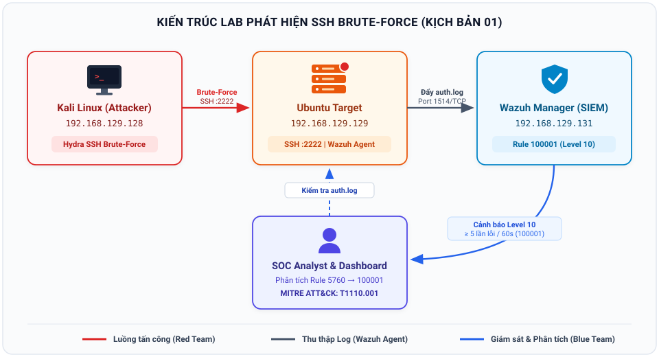

# Kịch bản 01: Phát hiện tấn công SSH Brute-Force (Detection Engineering)

## 1. Mục tiêu

Mô phỏng tấn công dò mật khẩu SSH bằng `Hydra`, dùng **Wazuh** giám sát log và xây dựng Custom Rule `100001` (Level 10, `MITRE T1110.001`) để chủ động kiểm soát ngưỡng phát hiện (≥ 5 lần thất bại / 60s từ cùng IP).

> Toàn bộ thử nghiệm thực hiện trong môi trường Lab riêng, chỉ phục vụ học tập và nghiên cứu phòng thủ.

## 2. Kiến trúc Lab

  

| Thành phần | Vai trò | Địa chỉ |
|---|---|---|
| Kali Linux | Máy tấn công (`Hydra`) | `192.168.129.128` |
| Ubuntu Target | SSH Server (port `2222`) + Wazuh Agent | `192.168.129.129` |
| Wazuh Manager | Phân tích log, nổ Rule `100001` | `192.168.129.131` |

**Luồng xử lý:** Hydra tấn công SSH → Ubuntu ghi `/var/log/auth.log` → Agent gửi log về Manager → Manager khớp Rule mặc định `5760` và tương quan theo IP nguồn → nổ Rule `100001`.

## 3. Kết quả chính

- **Tấn công:** `hydra -l root -P passwords.txt ssh://192.168.129.129:2222 -t 4`

- **Log Endpoint & cảnh báo mặc định:** `auth.log` ghi nhận các lần thất bại; Wazuh nổ các rule mặc định `5760`, `5551`, `2502`.

- **Custom Rule `100001`:** Level 10, `frequency=5`, `timeframe=60`, `same_source_ip`, gắn `T1110.001` (chi tiết file luật: `detection-rules/ssh_bruteforce_rule.xml`).

## 4. Kết luận

Chuyển từ phụ thuộc luật mặc định sang chủ động thiết kế luật theo tần suất, gắn nhãn MITRE ATT&CK, tạo tín hiệu tin cậy cho phản ứng tự động ở [Kịch bản 02](../02-auto-ban/README.md).

> Chi tiết các bước cấu hình: xem document dự án.
