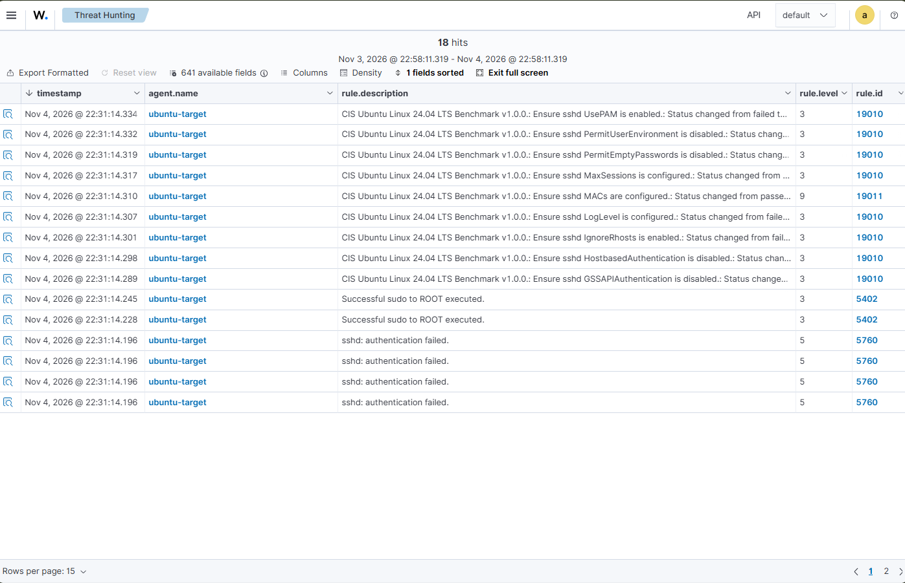
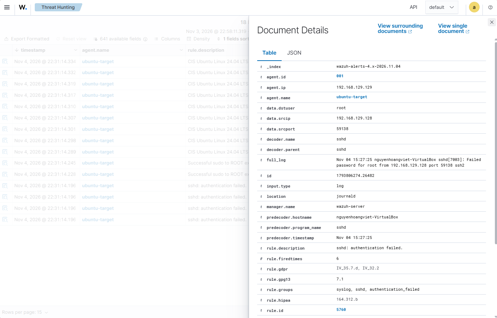
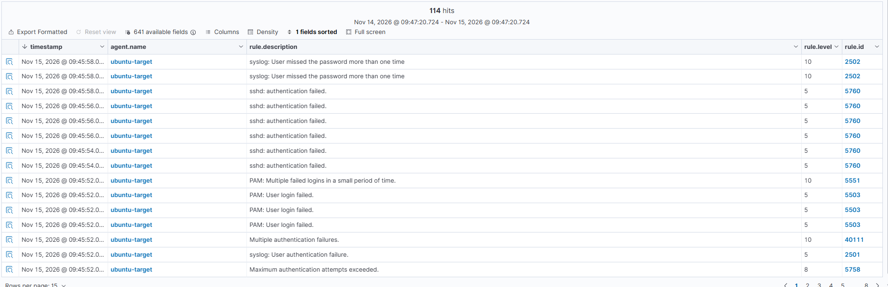

# Kịch bản 01: Mô phỏng và phát hiện tấn công SSH Brute-Force (Detection Engineering)

## 1. Mục tiêu

Kịch bản này mô phỏng một cuộc tấn công dò mật khẩu (SSH Brute-Force) vào máy chủ mục tiêu, sau đó sử dụng hệ thống SIEM **Wazuh** để giám sát log, phân tích cảnh báo mặc định và thực hành **Detection Engineering** thông qua việc xây dựng Custom Detection Rule (`100001`, Level 10, `MITRE T1110.001`).

| Giai đoạn | Cơ chế | Mục tiêu chính |
|---|---|---|
| **Giai đoạn 1: Mô phỏng tấn công** | `Hydra` (Red Team) | Tạo hàng loạt yêu cầu đăng nhập SSH thất bại liên tiếp từ cùng một IP nguồn |
| **Giai đoạn 2: Xác minh & Cảnh báo mặc định** | `/var/log/auth.log` + Wazuh Rules (`5760`, `5551`, `2502`) | Đối chiếu log cục bộ trên Endpoint và quan sát cơ chế phát hiện mặc định của SIEM |
| **Giai đoạn 3: Detection Engineering** | Wazuh Custom Rule `100001` (Level 10) | Chủ động kiểm soát ngưỡng phát hiện ($\ge 5$ lần thất bại / $60\text{s}$ từ cùng IP) và ánh xạ MITRE ATT&CK |

> **Lưu ý:** Toàn bộ thử nghiệm được thực hiện trong môi trường Lab riêng, chỉ phục vụ mục đích học tập và nghiên cứu phòng thủ.

---

## 2. Kiến trúc và môi trường Lab

<p align="center">
  
</p>

### 2.1. Các thành phần

| Thành phần | Vai trò | Địa chỉ IP / Cấu hình |
|---|---|---|
| Kali Linux | Máy mô phỏng tấn công SSH Brute-Force (`Hydra`) | `192.168.129.128` |
| Ubuntu Target | Máy chủ SSH và Wazuh Agent | `192.168.129.129`, SSH port `2222` |
| Wazuh Manager | Thu thập log, giải mã và kích hoạt Custom Rule `100001` | `192.168.129.131` (Standalone VM) |

### 2.2. Luồng xử lý phát hiện

1. Kali Linux sử dụng `Hydra` gửi liên tiếp các yêu cầu đăng nhập SSH sai mật khẩu đến Ubuntu Target qua port `2222`.
2. Hệ điều hành Ubuntu ghi nhận các sự kiện xác thực thất bại vào `/var/log/auth.log`.
3. Wazuh Agent đọc log xác thực và gửi về Wazuh Manager qua port `1514/TCP` theo thời gian thực.
4. Wazuh Manager giải mã sự kiện (khớp Rule mặc định `5760`), thực hiện tương quan tần suất theo IP nguồn và kích hoạt Custom Rule `100001` (Level 10, `T1110.001`) lên Dashboard.

---

## 3. Cấu trúc thư mục

```text
01-ssh-bruteforce/
│
├── README.md
│
├── diagrams/
│   └── architecture_01.svg
│
├── detection-rules/
│   └── ssh_bruteforce_rule.xml
│
└── screenshots/
    ├── hydra-attack-running.png
    ├── auth-log-failed.png
    ├── wazuh-alert-dashboard.png
    └── wazuh-custom-rule.png
```

File luật phát hiện hoàn chỉnh: [`detection-rules/ssh_bruteforce_rule.xml`](./detection-rules/ssh_bruteforce_rule.xml).

---

## 4. Giai đoạn 1 – Mô phỏng tấn công SSH Brute-Force

Từ máy Kali Linux (`192.168.129.128`), chạy `hydra` với danh sách mật khẩu giả lập (`passwords.txt`) nhắm vào dịch vụ SSH cổng `2222` trên Ubuntu Target:

```bash
hydra -l root -P passwords.txt ssh://192.168.129.129:2222 -t 4
```

**Kết quả mong đợi:** Hydra liên tục thử đăng nhập, tạo ra chuỗi sự kiện xác thực thất bại dồn dập trên máy chủ mục tiêu.


---

## 5. Giai đoạn 2 – Xác minh log cục bộ và cảnh báo mặc định

### Bước 1: Kiểm tra log xác thực trên Ubuntu Target

Kiểm tra nhanh file `/var/log/auth.log` để xác nhận hệ điều hành đã ghi nhận các phiên đăng nhập thất bại từ IP `192.168.129.128`:

```bash
sudo grep -a "Failed password" /var/log/auth.log | tail -n 10
```



### Bước 2: Quan sát cảnh báo mặc định trên Wazuh Dashboard

Wazuh tự động phân tích log SSH bằng bộ luật mặc định (Out-of-the-box Rules):

| Rule ID | Level | Mô tả |
|---|---:|---|
| `5760` | 5 | SSH authentication failed |
| `5551` | 10 | PAM: Multiple failed logins in a short period |
| `2502` | 10 | Phát hiện nhiều lần nhập sai mật khẩu |

Truy cập **Threat Hunting → Events** trên Wazuh Dashboard và lọc theo `agent.name: ubuntu-target` để quan sát các cảnh báo mặc định cùng địa chỉ IP nguồn tấn công.



---

## 6. Giai đoạn 3 – Xây dựng Custom Detection Rule (`100001`)

### Bước 1: Triển khai Custom Rule trên Wazuh Manager

Bổ sung Custom Rule `100001` vào tệp `/var/ossec/etc/rules/local_rules.xml` nhằm chủ động kiểm soát ngưỡng phát hiện hành vi Brute-Force:

```xml
<group name="local,syslog,sshd,">
  <rule id="100001" level="10" frequency="5" timeframe="60">
    <if_matched_sid>5760</if_matched_sid>
    <same_source_ip />
    <description>SSH Brute-Force Attack Detected: Multiple failed SSH login attempts from the same source IP.</description>
    <mitre>
      <id>T1110.001</id>
    </mitre>
  </rule>
</group>
```

| Thuộc tính | Giá trị | Ý nghĩa |
|---|---|---|
| `rule id` / `level` | `100001` / `10` | Định danh Custom Rule ở mức cảnh báo cao (High) |
| `frequency` / `timeframe` | `5` / `60` giây | Kích hoạt khi có tối thiểu 5 lần lỗi trong 60 giây |
| `if_matched_sid` | `5760` | Dựa trên sự kiện đăng nhập SSH thất bại |
| `same_source_ip` | Bật | Tương quan các sự kiện xuất phát từ cùng một IP |
| `mitre.id` | `T1110.001` | Ánh xạ kỹ thuật Password Guessing (MITRE ATT&CK) |

Khởi động lại Wazuh Manager để áp dụng luật mới:

```bash
sudo systemctl restart wazuh-manager
```

### Bước 2: Xác minh cảnh báo Custom Rule trên Dashboard

Chạy lại đợt kiểm thử Hydra và lọc trên Wazuh Dashboard theo `rule.id: 100001`.

**Kết quả mong đợi:** Dashboard hiển thị cảnh báo Level 10 từ Custom Rule `100001` kèm đầy đủ IP nguồn và mã kỹ thuật `T1110.001`.



---

## 7. Hướng phát triển tiếp theo

- **Active Response & SOAR:** Tự động chặn hoặc chặn thủ công IP tấn công bằng `iptables` khi Rule `100001` kích hoạt — được triển khai ở [Kịch bản 02 – SOAR: Auto-Ban và Manual Ban qua Telegram](../02-auto-ban/README.md).
- **Threat Intelligence:** Tích hợp nguồn dữ liệu Threat Intelligence để làm giàu ngữ cảnh cho địa chỉ IP nguồn trước khi ra quyết định xử lý.

---

## 8. Kết luận

Kịch bản 01 đặt nền móng cho chuỗi phòng thủ và tự động hóa trong Lab:

- **Endpoint & Log:** Xác minh quy trình thu thập log xác thực SSH (`/var/log/auth.log`) từ Ubuntu Target về Wazuh Manager.
- **Detection Engineering:** Chuyển từ phụ thuộc luật mặc định sang chủ động thiết kế Custom Rule `100001` theo ngưỡng tần suất (`frequency`/`timeframe`) và gắn nhãn MITRE ATT&CK (`T1110.001`).
- **Khả năng mở rộng:** Tạo tín hiệu cảnh báo có độ tin cậy cao (Level 10), sẵn sàng kết nối sang các kịch bản phản ứng tự động (SOAR) ở giai đoạn tiếp theo.