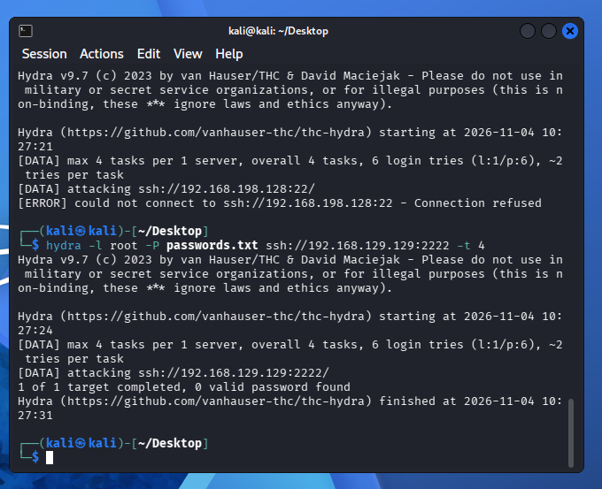
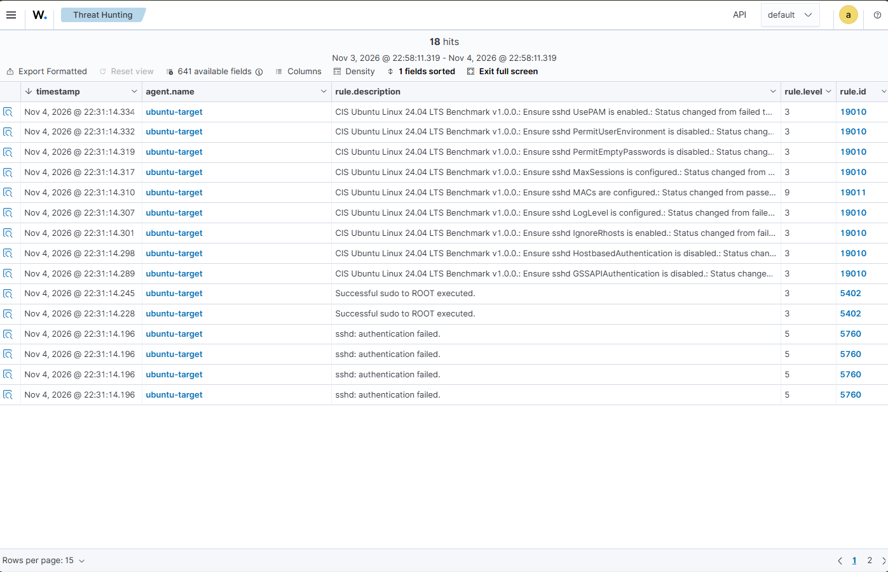
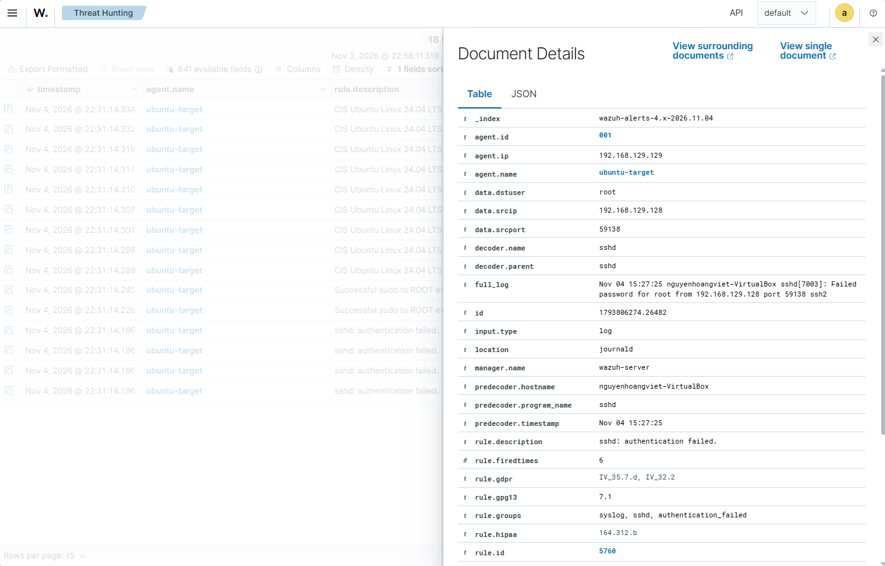

# Kịch bản 01: Mô phỏng và Phát hiện Tấn công SSH Brute-Force

## 🎯 1. Mục tiêu

Kịch bản này mô phỏng một cuộc tấn công dò mật khẩu (SSH Brute-Force) vào máy chủ mục tiêu. Sau đó, sử dụng hệ thống SIEM **Wazuh** để tự động phát hiện, ghi nhận và cảnh báo hành vi tấn công dựa trên các bộ quy tắc (Rules) mặc định.

## 🏗️ 2. Môi trường Lab (Topology)

| Thành phần  | Hệ thống      | Địa chỉ IP / Cấu hình |
| ----------- | ------------- | --------------------- |
| Attacker    | Kali Linux    | `192.168.129.128`     |
| Target      | Ubuntu Target | `192.168.129.129`     |
| SSH Service | Ubuntu Target | Port `2222`           |
| SIEM        | Wazuh Server  | Standalone VM         |

**Công cụ sử dụng:** `Hydra`, `grep`, `journalctl`, Wazuh Dashboard.

## 🛠️ 3. Các bước thực hiện

### Bước 1: Red Team – Thực hiện tấn công Brute-Force

Từ máy Kali Linux, sử dụng công cụ `hydra` để thử đăng nhập SSH vào máy Ubuntu Target thông qua cổng `2222`, sử dụng danh sách mật khẩu `passwords.txt`.

```bash
hydra -l root -P passwords.txt ssh://192.168.129.129:2222 -t 4
```

**Kết quả:** Hydra thực hiện nhiều lần thử đăng nhập SSH bằng các mật khẩu trong danh sách.



### Bước 2: Blue Team – Kiểm tra Log hệ thống (Local)

Trên máy Ubuntu Target, kiểm tra log xác thực để xác nhận hệ điều hành đã ghi nhận các lần đăng nhập thất bại.

```bash
sudo grep -a "Failed password" /var/log/auth.log | tail -n 10
```

**Kết quả:** Log ghi nhận các lần đăng nhập SSH thất bại, bao gồm địa chỉ IP nguồn `192.168.129.128` của máy Kali Linux.



### Bước 3: Detection Engineering – Giám sát trên Wazuh Dashboard

Wazuh sử dụng các bộ quy tắc mặc định (Out-of-the-box Rules) để phân tích log xác thực từ máy Ubuntu Target. Khi phát hiện các sự kiện đăng nhập thất bại, hệ thống tạo cảnh báo tương ứng.

Thông tin rule được sử dụng trong kịch bản:

| Thuộc tính   | Giá trị                         |
| ------------ | ------------------------------- |
| Rule ID      | `5760`                          |
| Rule Level   | `5`                             |
| MITRE ATT&CK | `T1110.001 – Password Guessing` |

Truy cập Wazuh Dashboard và lọc theo agent:

```text
agent.name: ubuntu-target
```

**Kết quả:** Dashboard hiển thị các sự kiện đăng nhập thất bại được Wazuh phát hiện, hỗ trợ theo dõi địa chỉ IP nguồn và điều tra hành vi tấn công.



## 🚀 4. Hướng phát triển tiếp theo (Next Steps)

- **Custom Detection Rule:** Xây dựng rule riêng để nhận diện chuỗi đăng nhập thất bại với mức cảnh báo cao hơn.
- **Active Response:** Cấu hình Wazuh Active Response để tự động chặn IP nguồn thông qua tường lửa khi phát hiện hành vi Brute-Force.
- **Incident Investigation:** Phân tích mối liên hệ giữa log xác thực trên Ubuntu Target và cảnh báo tương ứng trên Wazuh Dashboard.
