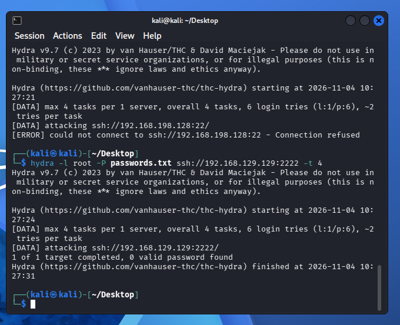

# Kịch bản 01: Mô phỏng và Phát hiện Tấn công SSH Brute-Force (Detection Engineering)

## 🎯 1. Mục tiêu

Kịch bản này mô phỏng một cuộc tấn công dò mật khẩu (SSH Brute-Force) vào máy chủ mục tiêu. Sau đó, sử dụng hệ thống SIEM **Wazuh** để giám sát, phân tích các cảnh báo mặc định và thực hành **Detection Engineering** thông qua việc xây dựng luật phát hiện tùy chỉnh (Custom Detection Rule).

Mục tiêu chính là nhận diện hành vi đăng nhập SSH thất bại liên tục từ cùng một địa chỉ IP, thiết lập ngưỡng phát hiện và nâng mức cảnh báo lên **Level 10** khi phát hiện dấu hiệu Brute-Force.

## 🏗️ 2. Môi trường Lab (Topology)

| Thành phần | Hệ thống | Địa chỉ IP / Cấu hình |
|---|---|---|
| Attacker | Kali Linux | `192.168.129.128` |
| Target | Ubuntu Target | `192.168.129.129` |
| SSH Service | Ubuntu Target | Port `2222` |
| SIEM | Wazuh Server | Standalone VM |

**Công cụ sử dụng:** `Hydra`, `grep`, `journalctl`, Wazuh Dashboard, Wazuh Custom Rules.

## 🛠️ 3. Các bước thực hiện

### Bước 1: Red Team – Thực hiện tấn công Brute-Force

Từ máy Kali Linux, tạo danh sách gồm 50 mật khẩu giả lập để mô phỏng quá trình dò mật khẩu. Sau đó, sử dụng công cụ `hydra` để thực hiện nhiều lần đăng nhập SSH vào máy Ubuntu Target thông qua cổng `2222`.

```bash
# Tạo danh sách 50 mật khẩu giả lập
seq 1 50 > passwords.txt

# Thực hiện tấn công SSH Brute-Force
hydra -l root -P passwords.txt ssh://192.168.129.129:2222 -t 4
```

**Kết quả:** Hydra liên tục thử đăng nhập bằng các mật khẩu trong danh sách, tạo ra nhiều sự kiện xác thực thất bại trên máy chủ mục tiêu.



### Bước 2: Blue Team – Kiểm tra Log hệ thống (Local)

Trên máy Ubuntu Target, kiểm tra file log xác thực để xác nhận hệ điều hành đã ghi nhận các lần đăng nhập SSH thất bại từ máy Kali Linux.

```bash
sudo grep -a "Failed password" /var/log/auth.log | tail -n 10
```

**Kết quả:** Log hệ thống ghi nhận nhiều lần đăng nhập thất bại, kèm theo địa chỉ IP nguồn `192.168.129.128`. Đây là bằng chứng cho thấy hoạt động Brute-Force đã được ghi nhận ở cấp độ hệ điều hành.


### Bước 3: Detection Engineering – Phân tích cảnh báo mặc định trên Wazuh

Wazuh sử dụng các bộ quy tắc mặc định (Out-of-the-box Rules) để phân tích log xác thực SSH được thu thập từ máy Ubuntu Target.

Khi xuất hiện các sự kiện đăng nhập thất bại, Wazuh tự động phân tích và tạo cảnh báo tương ứng.

Một số Rule liên quan đến quá trình phát hiện trong kịch bản:

| Rule ID | Rule Level | Mô tả |
|---|---:|---|
| `5760` | `5` | SSH authentication failed |
| `5551` | `10` | PAM: Multiple failed logins in a short period |
| `2502` | `10` | Phát hiện nhiều lần nhập sai mật khẩu |

Truy cập Wazuh Dashboard và lọc theo agent:

```text
agent.name: ubuntu-target
```

**Kết quả:** Dashboard hiển thị các sự kiện đăng nhập thất bại cùng thông tin địa chỉ IP nguồn và mức độ cảnh báo. Qua đó, có thể quan sát cách Wazuh sử dụng các Rule mặc định để nhận diện những hành vi bất thường.


### Bước 4: Detection Engineering – Xây dựng Custom Detection Rule

Sau khi phân tích các cảnh báo mặc định, tiến hành xây dựng một luật phát hiện tùy chỉnh nhằm chủ động kiểm soát ngưỡng nhận diện hành vi SSH Brute-Force.

**Yêu cầu phát hiện:**

- Theo dõi các sự kiện đăng nhập SSH thất bại được nhận diện bởi Rule `5760`.
- Nếu xuất hiện ít nhất 5 lần trong vòng 60 giây từ cùng một địa chỉ IP nguồn, kích hoạt cảnh báo.
- Đặt mức độ cảnh báo là **Level 10** để đánh dấu hành vi có dấu hiệu Brute-Force.

**Vị trí cấu hình:**

```bash
sudo nano /var/ossec/etc/rules/local_rules.xml
```

**Mã nguồn Custom Rule:**

```xml
<group name="local,syslog,sshd,">
  <rule id="100001" level="10" frequency="5" timeframe="60">
    <if_matched_sid>5760</if_matched_sid>
    <same_source_ip />
    <description>SSH Brute-Force Attack Detected: Multiple failed SSH login attempts from the same source IP.</description>
    <mitre>
      <id>T1110.001</id>
    </mitre>
  </rule>
</group>
```

**Thông tin luật phát hiện:**

| Thuộc tính | Giá trị |
|---|---|
| Rule ID | `100001` |
| Rule Level | `10` |
| Frequency | `5` |
| Timeframe | `60 seconds` |
| Correlation | Cùng địa chỉ IP nguồn |
| MITRE ATT&CK | `T1110.001 – Password Guessing` |

Sau khi bổ sung luật, kiểm tra cấu hình và khởi động lại Wazuh Manager:

```bash
sudo systemctl restart wazuh-manager
```

Khi hệ thống nhận đủ số lượng sự kiện thỏa mãn điều kiện phát hiện, Custom Rule `100001` sẽ được kích hoạt và tạo cảnh báo Level 10.

**Kết quả mong đợi:** Wazuh Dashboard hiển thị cảnh báo với Rule ID `100001`, cho phép xác định hành vi SSH Brute-Force dựa trên ngưỡng phát hiện do người quản trị thiết lập.


## 🚀 4. Hướng phát triển tiếp theo (Next Steps)

- **Active Response:** Cấu hình Wazuh Active Response để tự động chặn địa chỉ IP nguồn thông qua `iptables` hoặc `UFW` khi Custom Rule phát hiện hành vi Brute-Force.
- **Incident Investigation:** Phân tích mối liên hệ giữa log xác thực trên Ubuntu Target và các cảnh báo trên Wazuh Dashboard nhằm xác định nguồn tấn công, thời điểm và tần suất thực hiện.
- **Threat Intelligence:** Tích hợp nguồn dữ liệu Threat Intelligence để đối chiếu địa chỉ IP đáng ngờ với các nguồn dữ liệu về mối đe dọa đã biết.