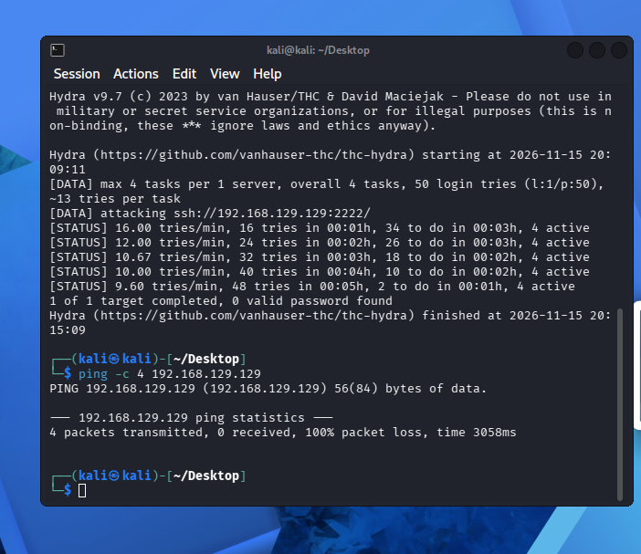
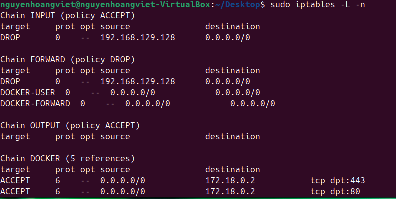
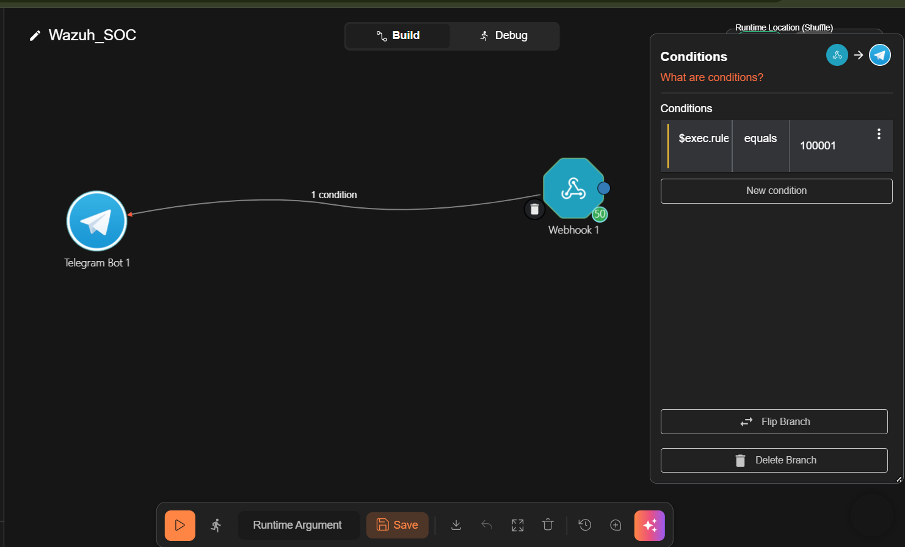
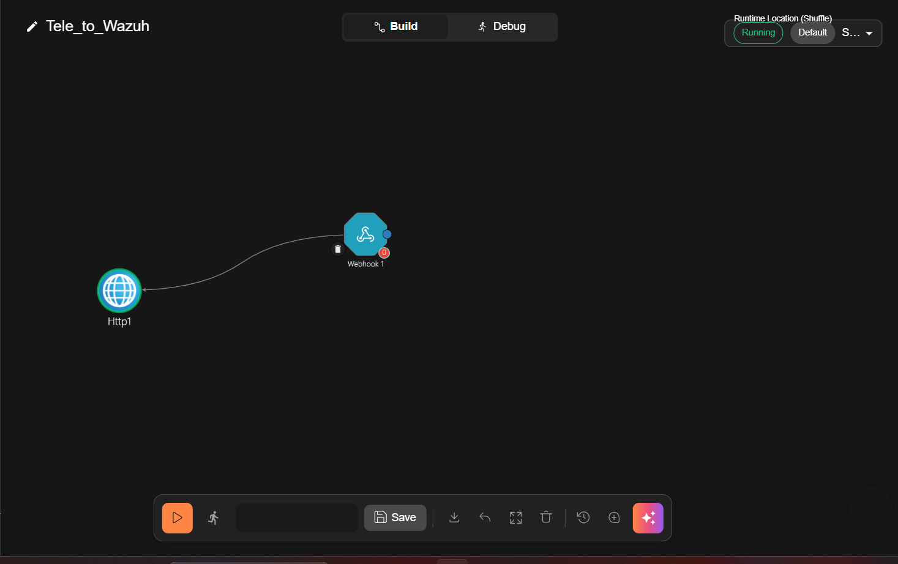

# Kịch bản 02: SOAR – Tự động chặn và chặn thủ công qua Telegram

## 1. Mục tiêu

Kịch bản này mở rộng từ [Kịch bản 01 – SSH Brute-Force](../01-ssh-bruteforce/README.md). Sau khi Wazuh phát hiện hành vi SSH Brute-Force bằng Custom Rule `100001` (Level 10), hệ thống có thể phản ứng theo hai cách:

| Hướng | Cơ chế | Người quyết định chặn |
|---|---|---|
| **A. Auto-Ban** | Wazuh Active Response gọi `firewall-drop` để chặn IP trên Ubuntu Agent | Hệ thống tự động |
| **B. Manual Ban** | Wazuh gửi cảnh báo qua n8n đến Telegram; Analyst nhấn nút **Ban**; n8n gọi Wazuh API để kích hoạt Active Response | Analyst xác nhận |

Mục tiêu là mô phỏng hai kiểu phản ứng thường gặp trong SOC:

- **Tự động hóa:** phản ứng nhanh với những cảnh báo có độ tin cậy cao.
- **Human-in-the-loop:** giữ người phân tích trong quy trình để kiểm tra trước khi chặn, hạn chế false positive.

> **Lưu ý khi kiểm thử:** Không nên bật Auto-Ban và Manual Ban cùng lúc cho một Rule nếu muốn quan sát riêng luồng thủ công. Khi Auto-Ban đã chặn IP ngay lúc phát hiện, Analyst có thể không còn cơ hội thực hiện thao tác Ban qua Telegram.

---

## 2. Kiến trúc và môi trường Lab

<p align="center">
  
</p>

### 2.1. Các thành phần

| Thành phần | Vai trò | Địa chỉ / Cấu hình |
|---|---|---|
| Kali Linux | Máy mô phỏng tấn công SSH Brute-Force | `192.168.129.128` |
| Ubuntu Target | Máy chủ SSH và Wazuh Agent | `192.168.129.129`, SSH port `2222` |
| Wazuh Manager | Thu thập sự kiện, phân tích và tạo cảnh báo | Wazuh Manager + API port `55000` |
| n8n | Nền tảng tự động hóa workflow | Port `5678` |
| Telegram Bot | Gửi cảnh báo và nhận thao tác Ban từ Analyst | Bot Telegram |
| ngrok | Tạo HTTPS endpoint công khai để Telegram gửi callback về n8n | URL HTTPS do ngrok cấp |
| iptables | Thực thi hành động DROP trên Ubuntu Target | Firewall của Ubuntu |

### 2.2. Hai luồng xử lý

**Luồng A – Auto-Ban**

1. Kali thực hiện SSH Brute-Force đến Ubuntu Target.
2. Wazuh Agent ghi nhận các sự kiện xác thực SSH và gửi log về Wazuh Manager.
3. Wazuh phân tích sự kiện và kích hoạt Custom Rule `100001` (Level 10).
4. Wazuh Active Response gọi `firewall-drop` trên Agent.
5. Ubuntu Target thêm luật DROP để chặn IP nguồn của cuộc tấn công.

**Luồng B – Manual Ban qua Telegram**

1. Kali thực hiện SSH Brute-Force; Wazuh phát hiện và tạo cảnh báo.
2. Cảnh báo được chuyển đến Webhook của workflow `Wazuh_SOC.json`.
3. n8n xử lý dữ liệu cảnh báo, lấy các thông tin cần thiết như IP nguồn, Agent và Rule.
4. n8n gửi tin nhắn Telegram kèm nút **Ban** cho Analyst.
5. Analyst kiểm tra cảnh báo và nhấn nút **Ban**.
6. Telegram gửi callback đến Webhook của workflow `Tele_to_Wazuh.json` thông qua URL HTTPS của ngrok.
7. n8n xác thực với Wazuh API và gửi yêu cầu kích hoạt Active Response.
8. Wazuh yêu cầu Agent chạy `firewall-drop`; Ubuntu Target chặn IP nguồn.
9. Workflow gửi phản hồi về Telegram để thông báo kết quả thao tác.

---

## 3. Cấu trúc thư mục

```text
02-auto-ban/
│
├── README.md
├── Wazuh_SOC.json
├── Tele_to_Wazuh.json
│
├── diagrams/
│   └── architecture.svg
│
└── screenshots/
    ├── 1_Kali_Hydra_Bi_Treo.png
    ├── 2_Telegram_CanhBao_Level10.png
    ├── 3_Ubuntu_Log_ThucThi_ActiveResponse.png
    ├── 4_Ubuntu_Iptables_Drop_IP.png
    ├── Ban_Thu_Cong.png
    ├── tele_to_wazuh.png
    ├── Thong_Bao_Tan_Cong.png
    └── wazuh_soc.png
```

### 3.1. Hai workflow n8n

Hai file JSON là các workflow được export từ n8n. Có thể mở trực tiếp để tải về hoặc import vào n8n:

- **[Wazuh_SOC.json – Workflow nhận cảnh báo và gửi Telegram](./Wazuh_SOC.json)**
- **[Tele_to_Wazuh.json – Workflow nhận lệnh Ban và gọi Wazuh API](./Tele_to_Wazuh.json)**

| File | Nhiệm vụ chính | Điểm bắt đầu |
|---|---|---|
| `Wazuh_SOC.json` | Nhận cảnh báo Wazuh, chuẩn hóa dữ liệu, gửi Telegram kèm nút Ban | Webhook nhận alert |
| `Tele_to_Wazuh.json` | Nhận callback khi Analyst nhấn Ban, xác thực Wazuh API, yêu cầu Active Response và phản hồi kết quả | Webhook nhận callback từ Telegram |

---

## 4. Chuẩn bị môi trường

### 4.1. Điều kiện cần

- Đã triển khai Wazuh Manager và Ubuntu Wazuh Agent.
- Ubuntu Target đã bật dịch vụ SSH trên port `2222`.
- Custom Rule `100001` đã hoạt động và tạo cảnh báo Level 10.
- Đã cài Docker để chạy n8n (hoặc đã có một n8n instance).
- Đã tạo Telegram Bot bằng `@BotFather`.
- Đã cài ngrok và có Authtoken nếu sử dụng Telegram callback qua Internet.

### 4.2. Kiểm tra `firewall-drop` trên Ubuntu Target

```bash
sudo ls -l /var/ossec/active-response/bin/firewall-drop
```

Wazuh thường cung cấp sẵn script `firewall-drop`. Nếu file tồn tại, không cần tự tạo một script trùng tên.

### 4.3. Thông tin cần chuẩn bị trước khi import workflow

| Thông tin | Dùng ở đâu |
|---|---|
| Telegram Bot Token | Credential của các node Telegram hoặc HTTP Request |
| Telegram Chat ID | Xác định nơi nhận cảnh báo |
| IP/hostname Wazuh Manager | Địa chỉ gọi Wazuh API |
| Wazuh API username/password | Xác thực để lấy token |
| Agent ID của Ubuntu Target | Xác định Agent nhận lệnh Active Response |
| URL Webhook của n8n | Wazuh gửi alert và Telegram gửi callback |
| URL HTTPS ngrok | Địa chỉ công khai để Telegram gọi callback |

Không đưa Bot Token, mật khẩu Wazuh API, ngrok Authtoken hoặc token truy cập vào README hay commit lên GitHub. Hãy lưu chúng trong Credentials/biến môi trường của n8n.

---

# HƯỚNG A – TỰ ĐỘNG CHẶN (AUTO-BAN)

## 5. Cấu hình Wazuh Active Response

### Bước 1: Kiểm tra cấu hình trên Wazuh Manager

Mở cấu hình:

```bash
sudo nano /var/ossec/etc/ossec.conf
```

Trong thẻ `<ossec_config>`, kiểm tra khai báo `firewall-drop`. Nếu đã có khai báo tương ứng thì không thêm trùng. Nếu chưa có, cấu hình command và active response như sau:

```xml
<command>
  <name>firewall-drop</name>
  <executable>firewall-drop</executable>
  <timeout_allowed>yes</timeout_allowed>
</command>

<active-response>
  <command>firewall-drop</command>
  <location>local</location>
  <rules_id>100001</rules_id>
  <timeout>600</timeout>
</active-response>
```

| Thuộc tính | Ý nghĩa |
|---|---|
| `command` | Chọn script `firewall-drop` |
| `location` | `local` – thực thi trên Agent phát sinh cảnh báo |
| `rules_id` | Chỉ kích hoạt với Rule ID `100001` |
| `timeout` | Thời gian chặn 600 giây (10 phút), sau đó Active Response sẽ gỡ chặn theo cơ chế timeout |

Khởi động lại Wazuh Manager:

```bash
sudo systemctl restart wazuh-manager
```

### Bước 2: Mô phỏng SSH Brute-Force từ Kali

Tạo danh sách mật khẩu thử nghiệm:

```bash
seq 1 50 > passwords.txt
```

Chạy Hydra từ Kali Linux:

```bash
hydra -l root -P passwords.txt ssh://192.168.129.129:2222 -t 4
```

**Kết quả mong đợi:** Khi Wazuh phát hiện đủ sự kiện để kích hoạt Rule `100001`, Active Response được gọi. Kết nối SSH từ IP nguồn có thể bị gián đoạn do firewall chặn.



### Bước 3: Kiểm tra cảnh báo Telegram

Workflow cảnh báo gửi thông tin sự kiện đến Telegram.


### Bước 4: Kiểm tra log Active Response trên Ubuntu Target

```bash
sudo tail -n 20 /var/ossec/logs/active-responses.log
```

Đối chiếu log để xác nhận `firewall-drop` được gọi và kiểm tra IP nguồn được xử lý.


### Bước 5: Kiểm tra luật iptables

```bash
sudo iptables -L INPUT -n --line-numbers
```

Tìm luật `DROP` tương ứng với IP nguồn `192.168.129.128`.



**Nhận xét:** Nếu log Active Response ghi nhận thực thi và iptables hiển thị luật DROP cho IP nguồn, luồng Auto-Ban đã hoạt động. Với cấu hình timeout 600 giây, Wazuh sẽ xử lý việc gỡ luật khi hết thời gian chặn.

---

# HƯỚNG B – CHẶN THỦ CÔNG QUA TELEGRAM (MANUAL BAN)

Ở hướng này, Analyst là người xác nhận hành động chặn. Để kiểm thử đúng luồng Human-in-the-loop, hãy tạm thời vô hiệu hóa `<active-response>` tự động áp dụng cho Rule `100001`. Nếu không, IP có thể đã bị chặn trước khi Analyst nhấn nút Ban.

## 6. Tổng quan hai workflow

### 6.1. Workflow 1 – `Wazuh_SOC.json`

<badge color="info">Wazuh → n8n → Telegram</badge>

**Mục đích:** Tiếp nhận cảnh báo từ Wazuh, xử lý nội dung và gửi thông báo đến Telegram để Analyst theo dõi.

Luồng xử lý logic:

| Thứ tự | Thành phần / công đoạn | Nhiệm vụ |
|---|---|---|
| 1 | **Webhook Trigger** | Tạo endpoint để tiếp nhận alert JSON từ Wazuh |
| 2 | **Parse / Process Alert** | Đọc cấu trúc alert, lấy các trường cần thiết |
| 3 | **Extract Alert Fields** | Trích xuất IP nguồn (`srcip`), Agent, Rule ID, mức độ cảnh báo và thời gian |
| 4 | **Format Telegram Message** | Tạo nội dung cảnh báo dễ đọc, giúp Analyst nhận biết sự kiện |
| 5 | **Create Ban Action** | Đính kèm nút **Ban** cùng dữ liệu cần thiết để xác định IP/Agent khi callback được gửi về |
| 6 | **Telegram Send Message** | Gửi thông báo đến Chat ID đã cấu hình |

**Dữ liệu quan trọng cần được giữ trong cảnh báo:**

- `srcip`: IP nguồn cần xem xét chặn.
- `agent.id` / Agent ID: định danh máy Ubuntu Target.
- `rule.id`: Rule đã phát hiện sự kiện, trong kịch bản này là `100001`.
- `rule.level`: mức độ cảnh báo, trong kịch bản này là Level 10.
- Thời gian và mô tả cảnh báo để Analyst có thêm ngữ cảnh.

**Kết quả đầu ra:** Telegram hiển thị cảnh báo SSH Brute-Force và nút **Ban**. Analyst có thể kiểm tra IP nguồn và thông tin sự kiện trước khi quyết định.



### 6.2. Workflow 2 – `Tele_to_Wazuh.json`

<badge color="success">Telegram → n8n → Wazuh API</badge>

**Mục đích:** Tiếp nhận thao tác Ban từ Telegram, xác thực với Wazuh API và yêu cầu Wazuh thực thi Active Response.

Luồng xử lý logic:

| Thứ tự | Thành phần / công đoạn | Nhiệm vụ |
|---|---|---|
| 1 | **Telegram Callback Webhook** | Nhận callback khi Analyst nhấn nút **Ban** |
| 2 | **Extract Callback Data** | Đọc dữ liệu callback, lấy IP nguồn và thông tin Agent cần xử lý |
| 3 | **Validate Input** | Kiểm tra dữ liệu đầu vào; không tiếp tục nếu thiếu IP hoặc thông tin định danh cần thiết |
| 4 | **Wazuh API Authentication** | Gửi thông tin xác thực đến Wazuh API để lấy access token |
| 5 | **Active Response Request** | Gửi yêu cầu đến endpoint Active Response, chỉ định `firewall-drop` và Agent mục tiêu |
| 6 | **Handle API Result** | Kiểm tra kết quả trả về để xác định yêu cầu được chấp nhận hay gặp lỗi |
| 7 | **Telegram Response** | Gửi phản hồi về Telegram để Analyst biết kết quả xử lý |

**Kết quả đầu ra:** Khi yêu cầu được Wazuh chấp nhận và Agent thực thi thành công, IP nguồn được chặn bằng `firewall-drop`. Cần phân biệt phản hồi API chấp nhận yêu cầu với việc đã xác minh luật DROP thực tế trên Agent.



---

## 7. Triển khai workflow Manual Ban

### Bước 1: Khởi chạy n8n

Ví dụ chạy n8n bằng Docker:

```bash
docker run -d --name n8n \
  -p 5678:5678 \
  -v n8n_data:/home/node/.n8n \
  n8nio/n8n
```

Truy cập:

```text
http://localhost:5678
```

Tạo tài khoản quản trị n8n nếu đây là lần đầu khởi chạy.

### Bước 2: Import hai workflow JSON

Trong giao diện n8n:

1. Mở khu vực **Workflows**.
2. Chọn **Import from File**.
3. Chọn file `Wazuh_SOC.json`.
4. Thực hiện lại thao tác trên với file `Tele_to_Wazuh.json`.
5. Mở từng workflow và kiểm tra các node sau khi import.

Có thể tải trực tiếp hai file workflow từ repository:

- [Wazuh_SOC.json](./Wazuh_SOC.json)
- [Tele_to_Wazuh.json](./Tele_to_Wazuh.json)

### Bước 3: Cấu hình Credentials và các giá trị môi trường

Sau khi import, kiểm tra các node có sử dụng thông tin kết nối:

| Thành phần | Giá trị cần cấu hình |
|---|---|
| Telegram | Bot Token và Chat ID |
| Webhook nhận alert | Đường dẫn endpoint được workflow tạo ra |
| Wazuh API | Địa chỉ `https://<WAZUH_MANAGER_IP>:55000` |
| Wazuh API Authentication | Username/password có quyền phù hợp |
| Agent mục tiêu | Agent ID của Ubuntu Target |
| Callback Telegram | Webhook URL công khai mà Telegram có thể truy cập |

Tên node và cách biểu diễn dữ liệu có thể khác tùy phiên bản n8n hoặc cách workflow được xây dựng. Vì vậy, sau khi import, cần mở từng node để kiểm tra URL, credential, expression và dữ liệu đầu vào; không chỉ bật workflow ngay.

### Bước 4: Tạo HTTPS endpoint bằng ngrok

Telegram cần gọi được callback endpoint từ Internet. Nếu n8n đang chạy trong mạng nội bộ, có thể dùng ngrok để tạo HTTPS tunnel:

```bash
ngrok config add-authtoken <NGROK_AUTHTOKEN>
```

Mở tunnel đến n8n:

```bash
ngrok http 5678
```

Ngrok cung cấp một URL HTTPS có dạng:

```text
https://<NGROK_DOMAIN>
```

Cập nhật URL này trong cấu hình webhook/callback tương ứng của workflow. Nếu n8n cần biết URL bên ngoài để tạo webhook URL chính xác, cấu hình `WEBHOOK_URL` theo URL ngrok, sau đó khởi động lại n8n và kích hoạt lại workflow theo yêu cầu của phiên bản n8n đang sử dụng.

> Với URL ngrok miễn phí, domain có thể thay đổi sau khi khởi động lại tunnel. Khi URL thay đổi, cần cập nhật lại webhook liên quan và đăng ký lại webhook Telegram nếu workflow sử dụng Telegram Trigger/callback.

Có thể kiểm tra trạng thái webhook Telegram bằng:

```bash
curl "https://api.telegram.org/bot<BOT_TOKEN>/getWebhookInfo"
```

Không chia sẻ URL chứa token hoặc Bot Token trong ảnh chụp màn hình công khai.

### Bước 5: Cấu hình Wazuh gửi alert đến workflow `Wazuh_SOC.json`

Lấy **Production URL** từ node Webhook trong workflow `Wazuh_SOC.json`. Sau đó cấu hình cơ chế chuyển alert từ Wazuh Manager đến URL đó.

Nếu dùng Wazuh custom integration, cần có script tích hợp tương ứng trong thư mục tích hợp của Wazuh, script này nhận alert JSON và chuyển tiếp đến Webhook n8n. Tên integration trong `ossec.conf` phải khớp với tên script đã cài đặt; không mặc định coi `shuffle` là tên tích hợp n8n.

Ví dụ cấu trúc khai báo integration (chỉ sử dụng sau khi đã cài đúng script tích hợp tương ứng):

```xml
<integration>
  <name>custom-n8n</name>
  <hook_url>https://<NGROK_DOMAIN>/<WEBHOOK_PATH></hook_url>
  <level>10</level>
  <alert_format>json</alert_format>
</integration>
```

Trong đó:

- `custom-n8n` phải khớp với tên script tích hợp thực tế.
- `hook_url` phải là Production URL của Webhook node trong workflow.
- `level` giới hạn việc chuyển tiếp các cảnh báo từ Level 10 trở lên.

Khởi động lại Wazuh Manager sau khi hoàn tất cấu hình:

```bash
sudo systemctl restart wazuh-manager
```

Kiểm tra log integration nếu alert không đến được n8n:

```bash
sudo tail -n 50 /var/ossec/logs/integrations.log
```

### Bước 6: Kiểm tra xác thực Wazuh API

Từ máy có thể kết nối đến Wazuh API, kiểm tra khả năng xác thực:

```bash
curl -k -u <API_USER>:<API_PASSWORD> -X POST \
  "https://<WAZUH_MANAGER_IP>:55000/security/user/authenticate?raw=true"
```

Nếu thành công, API trả về token để sử dụng trong request tiếp theo. Trong workflow, nên lấy token mới khi chạy hoặc xử lý trường hợp token hết hạn; không ghi cứng token lâu dài trong workflow.

### Bước 7: Kiểm tra endpoint Active Response

Workflow `Tele_to_Wazuh.json` cần gửi yêu cầu đến Wazuh API để kích hoạt Active Response trên Agent Ubuntu. Endpoint, query parameters và JSON body phải khớp với phiên bản Wazuh API đang sử dụng và cấu hình node trong workflow.

Về mặt logic, yêu cầu cần xác định:

- Command: `firewall-drop`.
- Agent đích: Agent ID của Ubuntu Target.
- IP nguồn: IP được Analyst xác nhận chặn.
- Thông tin xác thực: Bearer token vừa lấy từ Wazuh API.

Không nên coi việc API trả về thành công là bằng chứng duy nhất rằng firewall đã chặn IP. Cần kiểm tra log Active Response và iptables trên Agent ở bước xác minh.

### Bước 8: Kích hoạt và kiểm thử hai workflow

1. Kích hoạt workflow `Wazuh_SOC.json`.
2. Kích hoạt workflow `Tele_to_Wazuh.json`.
3. Tạo một sự kiện SSH Brute-Force từ Kali.
4. Kiểm tra workflow `Wazuh_SOC.json` có nhận alert và gửi tin nhắn Telegram hay không.
5. Kiểm tra Telegram có hiển thị đúng IP nguồn, Agent, Rule và nút **Ban** hay không.
6. Analyst nhấn **Ban**.
7. Kiểm tra execution của `Tele_to_Wazuh.json` để theo dõi callback, bước xác thực API và request Active Response.
8. Kiểm tra Telegram có nhận được phản hồi sau thao tác hay không.


---

## 8. Xác minh kết quả chặn

Trên Ubuntu Target, kiểm tra log Active Response:

```bash
sudo tail -n 20 /var/ossec/logs/active-responses.log
```

Kiểm tra firewall:

```bash
sudo iptables -L INPUT -n --line-numbers
```

Đối chiếu IP nguồn trong cảnh báo, ví dụ `192.168.129.128`, với luật DROP được tạo trên Ubuntu Target.

**Nhận xét:** Kết quả chỉ được xem là xác minh đầy đủ khi có thể đối chiếu được ba điểm: Analyst đã gửi thao tác Ban, Wazuh API đã tiếp nhận yêu cầu Active Response và Ubuntu Agent thực tế đã áp dụng luật DROP.

---

## 9. So sánh Auto-Ban và Manual Ban

| Tiêu chí | Auto-Ban | Manual Ban qua Telegram |
|---|---|---|
| Cơ chế | Wazuh tự kích hoạt Active Response | Analyst xác nhận qua Telegram |
| Tốc độ | Nhanh, gần như tự động | Phụ thuộc thời gian phản hồi của Analyst |
| Kiểm soát của con người | Không cần xác nhận từng cảnh báo | Có bước xác nhận trước khi chặn |
| Rủi ro false positive | Có thể chặn nhầm nếu Rule chưa đủ tin cậy | Giảm rủi ro nhờ bước kiểm tra |
| Thành phần | Wazuh Active Response, firewall-drop | Wazuh, n8n, Telegram, ngrok, Wazuh API |
| Phù hợp | Sự kiện rõ ràng, Rule có độ tin cậy cao | Sự kiện cần người phân tích đánh giá |

---

## 10. Xử lý sự cố thường gặp

| Hiện tượng | Nguyên nhân có thể | Hướng kiểm tra |
|---|---|---|
| Telegram không nhận cảnh báo | Webhook sai, workflow chưa Active hoặc Wazuh chưa chuyển được alert | Kiểm tra Production URL, trạng thái workflow và `integrations.log` |
| Workflow không nhận được callback Ban | URL ngrok thay đổi hoặc webhook Telegram chưa được đăng ký đúng | Kiểm tra `getWebhookInfo`, URL callback và trạng thái workflow |
| Wazuh API trả `401` | Sai tài khoản/mật khẩu hoặc token hết hạn | Kiểm tra thông tin xác thực và bước lấy token |
| API nhận yêu cầu nhưng IP chưa bị chặn | Sai Agent ID, command hoặc dữ liệu IP; Agent chưa thực thi | Kiểm tra execution của n8n, `active-responses.log` và `ossec.log` |
| Không thấy luật DROP | Active Response chưa chạy hoặc đang kiểm tra nhầm máy | Kiểm tra trên đúng Ubuntu Agent |
| Auto-Ban chặn trước khi Analyst nhấn nút | Cấu hình Auto-Ban vẫn đang áp dụng Rule `100001` | Tạm tắt active-response tương ứng khi kiểm thử Manual Ban |
| Wazuh không gửi được alert tới n8n | Chưa cài custom integration script hoặc tên integration không khớp | Kiểm tra script tích hợp và `integrations.log` |

---

## 11. Hướng phát triển

- **Whitelist:** loại trừ IP quản trị hoặc IP tin cậy khỏi hành động chặn.
- **Unban:** bổ sung nút gỡ chặn trên Telegram.
- **Phân quyền:** chỉ cho phép Telegram User ID/Chat ID được ủy quyền thực hiện Ban.
- **Threat Intelligence:** làm giàu thông tin IP bằng nguồn Threat Intelligence trước khi Analyst quyết định.
- **Ticketing:** tạo ticket sự cố trên nền tảng quản lý sự cố.
- **Audit Log:** lưu người thực hiện, thời gian, IP bị chặn và kết quả API để phục vụ truy vết.
- **Webhook ổn định:** sử dụng domain cố định hoặc giải pháp tunnel phù hợp cho môi trường triển khai lâu dài.

---

## 12. Kết luận

Kịch bản đã xây dựng hai cách phản ứng sau khi Wazuh phát hiện SSH Brute-Force. Auto-Ban minh họa khả năng phản ứng tự động bằng Active Response; Manual Ban minh họa mô hình Human-in-the-loop, trong đó Analyst nhận cảnh báo qua Telegram và chủ động xác nhận trước khi Wazuh thực hiện hành động chặn.

Việc tách riêng hai workflow n8n giúp phân chia rõ nhiệm vụ: `Wazuh_SOC.json` phụ trách tiếp nhận và thông báo cảnh báo, còn `Tele_to_Wazuh.json` phụ trách tiếp nhận quyết định của Analyst và yêu cầu Wazuh API thực thi phản ứng.
