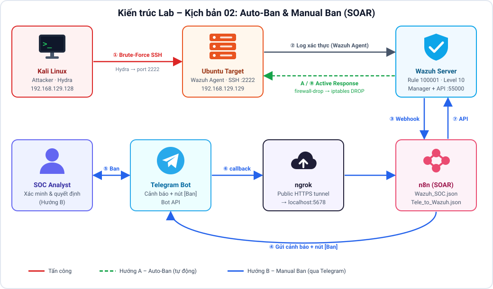
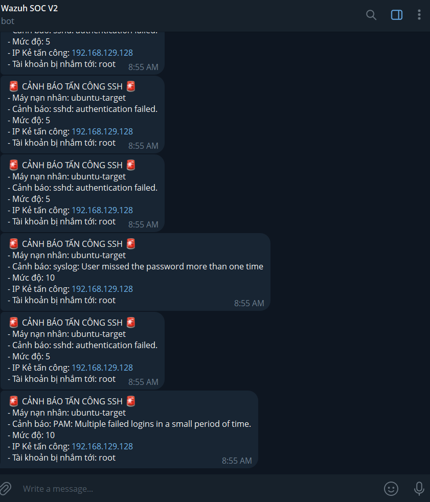
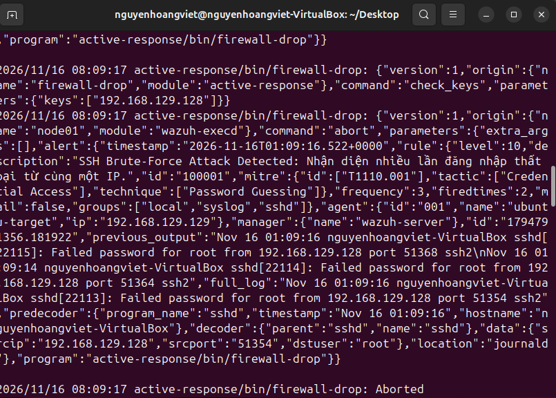
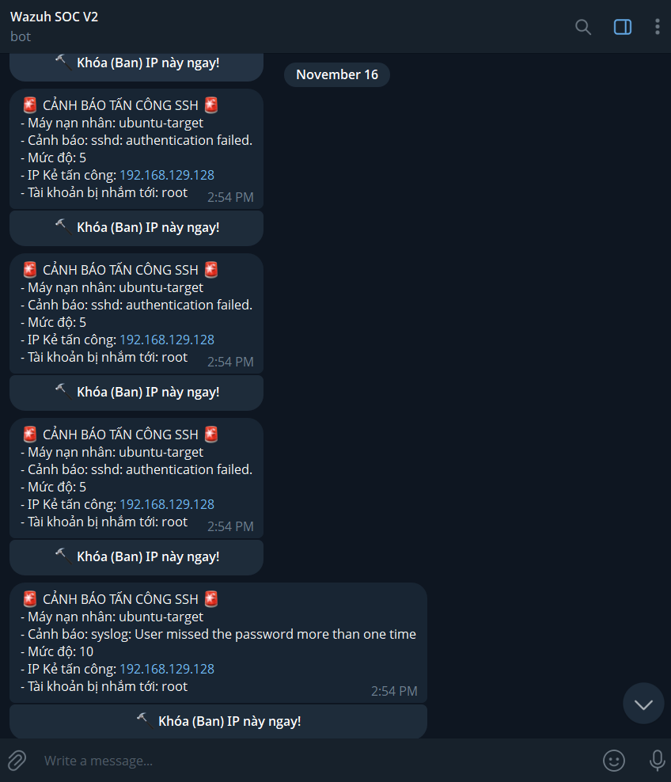
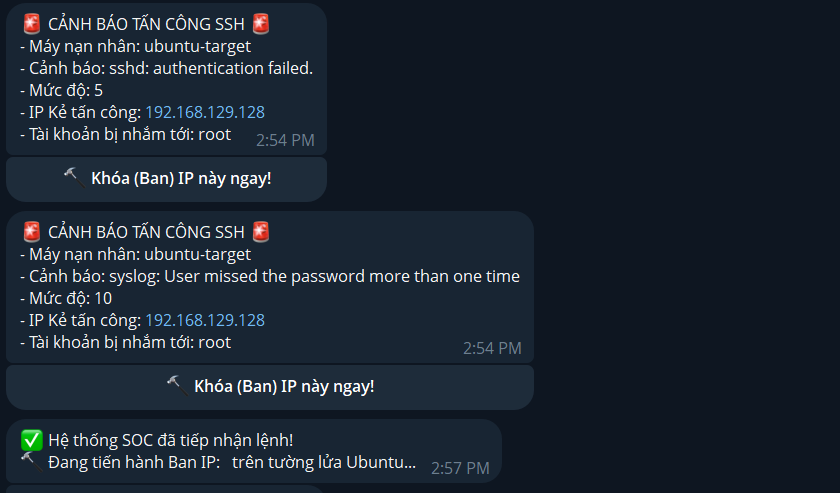

# Kịch bản 02: SOAR – Tự động chặn (Auto-Ban) và Chặn thủ công qua Telegram

## 1. Mục tiêu

Mở rộng từ [Kịch bản 01 – SSH Brute-Force](../01-ssh-bruteforce/README.md): sau khi Wazuh phát hiện tấn công bằng Custom Rule `100001` (Level 10), hệ thống triển khai hai mô hình phản ứng tiêu chuẩn trong SOC:

| Hướng | Cơ chế | Người quyết định |
|---|---|---|
| **A. Auto-Ban** | Wazuh Active Response gọi `firewall-drop` chặn trực tiếp IP nguồn trên Ubuntu Agent | Hệ thống tự động |
| **B. Manual Ban (Human-in-the-loop)** | Wazuh đẩy cảnh báo qua n8n tới Telegram; Analyst nhấn nút **Ban**; n8n gọi Wazuh API kích hoạt `firewall-drop` | Analyst xác nhận |

> **Lưu ý khi kiểm thử:** Tắt `<active-response>` tự động cho Rule `100001` khi kiểm thử Hướng B để tránh IP bị chặn trước khi Analyst kịp thao tác trên Telegram.

---

## 2. Kiến trúc và môi trường Lab

<p align="center">
  
</p>

| Thành phần | Vai trò | Địa chỉ / Cấu hình |
|---|---|---|
| Kali Linux | Máy mô phỏng tấn công SSH Brute-Force | `192.168.129.128` |
| Ubuntu Target | Máy chủ SSH, Wazuh Agent và `iptables` | `192.168.129.129`, SSH port `2222` |
| Wazuh Manager | Phân tích log, kích hoạt Rule `100001` và cung cấp API | Wazuh Manager + API port `55000` |
| n8n + ngrok | Nền tảng SOAR điều phối workflow và tạo HTTPS callback công khai | n8n port `5678` + HTTPS tunnel |
| Telegram Bot | Gửi cảnh báo Level 10 và nhận thao tác nhấn nút **Ban** | Bot Telegram |

**Luồng xử lý:**
- **Luồng A (Auto-Ban):** Kali Brute-Force → Ubuntu đẩy log → Wazuh Manager nổ Rule `100001` → Active Response gọi `firewall-drop` → `iptables` chèn luật `DROP` IP nguồn.
- **Luồng B (Manual Ban):** Wazuh nổ Rule `100001` → Webhook đẩy alert sang `Wazuh_SOC.json` → n8n gửi cảnh báo kèm nút **Ban** về Telegram → Analyst nhấn **Ban** → Telegram gọi callback (qua ngrok) về `Tele_to_Wazuh.json` → n8n xác thực Wazuh API, kích hoạt `firewall-drop` trên Agent và phản hồi kết quả về Telegram.

---

## 3. Cấu trúc thư mục

```text
02-auto-ban/
├── README.md
├── Wazuh_SOC.json
├── Tele_to_Wazuh.json
├── diagrams/
│   └── architecture.svg
└── screenshots/
    ├── 1_Kali_Hydra_Bi_Treo.png
    ├── 2_Telegram_CanhBao_Level10.png
    ├── 3_Ubuntu_Log_ThucThi_ActiveResponse.png
    ├── 4_Ubuntu_Iptables_Drop_IP.png
    ├── wazuh_soc.png
    ├── tele_to_wazuh.png
    ├── Thong_Bao_Tan_Cong.png
    └── Ban_Thu_Cong.png
```

Hai workflow n8n đã export sẵn để import trực tiếp:
- [`Wazuh_SOC.json`](./Wazuh_SOC.json) – Nhận alert từ Wazuh, trích xuất `srcip`/Agent/Rule và gửi Telegram kèm nút **Ban**.
- [`Tele_to_Wazuh.json`](./Tele_to_Wazuh.json) – Nhận callback nút **Ban**, xác thực Wazuh API, kích hoạt Active Response và phản hồi Telegram.

---

## 4. Hướng A – Tự động chặn (Auto-Ban)

### 4.1. Cấu hình Wazuh Active Response

Bổ sung cấu hình `firewall-drop` trong `/var/ossec/etc/ossec.conf` trên Wazuh Manager (áp dụng cho Rule `100001`, tự gỡ chặn sau 600 giây), sau đó khởi động lại `wazuh-manager`:

```xml
<command>
  <name>firewall-drop</name>
  <executable>firewall-drop</executable>
  <timeout_allowed>yes</timeout_allowed>
</command>

<active-response>
  <command>firewall-drop</command>
  <location>local</location>
  <rules_id>100001</rules_id>
  <timeout>600</timeout>
</active-response>
```

### 4.2. Kiểm thử và xác minh kết quả

Chạy tấn công Hydra từ Kali Linux nhắm vào Ubuntu Target (`hydra -l root -P passwords.txt ssh://192.168.129.129:2222 -t 4`):

1. **Phía Attacker & Cảnh báo:** Ngay khi Rule `100001` kích hoạt, phiên Hydra bị treo do kết nối bị chặn và Telegram nhận cảnh báo Level 10.




2. **Xác minh trên Ubuntu Target:** Đối chiếu `/var/ossec/logs/active-responses.log` và bảng luật `iptables` xác nhận `firewall-drop` đã thực thi và chèn luật `DROP` cho IP `192.168.129.128`.




---

## 5. Hướng B – Chặn thủ công qua Telegram (Manual Ban)

### 5.1. Hai workflow điều phối trên n8n

Import hai file JSON vào n8n, cấu hình Credentials (Telegram Bot Token, Chat ID, Wazuh API `https://<WAZUH_MANAGER_IP>:55000`, Agent ID) và mở HTTPS tunnel bằng `ngrok http 5678` để Telegram gọi được callback:

- **Workflow 1 (`Wazuh_SOC.json`):** Webhook nhận alert JSON → trích xuất `srcip`, `agent.id`, `rule.id`, `rule.level` → gửi tin nhắn Telegram kèm nút **Ban**.


- **Workflow 2 (`Tele_to_Wazuh.json`):** Nhận callback từ Telegram → xác thực đầu vào → lấy Bearer Token từ Wazuh API → gọi endpoint Active Response (`firewall-drop`) tới Ubuntu Agent → gửi kết quả về Telegram.


### 5.2. Tích hợp chuyển tiếp cảnh báo từ Wazuh Manager

Khai báo khối `<integration>` trong `/var/ossec/etc/ossec.conf` trỏ về Production URL của Webhook `Wazuh_SOC.json` (khớp với custom integration script trên Manager) và khởi động lại `wazuh-manager`:

```xml
<integration>
  <name>custom-n8n</name>
  <hook_url>https://<NGROK_DOMAIN>/<WEBHOOK_PATH></hook_url>
  <level>10</level>
  <alert_format>json</alert_format>
</integration>
```

### 5.3. Kiểm thử luồng Human-in-the-loop

Kích hoạt cả hai workflow, mô phỏng lại SSH Brute-Force từ Kali. Telegram nhận thông báo tấn công kèm nút **Ban**; sau khi Analyst nhấn xác nhận, n8n gọi Wazuh API chèn luật `DROP` trên Ubuntu Target và gửi phản hồi hoàn tất.





---

## 6. So sánh Auto-Ban và Manual Ban

| Tiêu chí | Auto-Ban | Manual Ban qua Telegram |
|---|---|---|
| **Tốc độ phản ứng** | Tức thời, hoàn toàn tự động | Phụ thuộc thời gian xác nhận của Analyst |
| **Rủi ro False Positive** | Cao hơn nếu luật chưa đủ chặt | Thấp nhờ bước kiểm tra của con người |
| **Trường hợp phù hợp** | Sự kiện rõ ràng, độ tin cậy cao | Sự kiện nhạy cảm cần đánh giá ngữ cảnh |

---

## 7. Kết luận & Hướng phát triển

- **Kết quả:** Triển khai hoàn chỉnh cả hai cơ chế phản ứng sự cố (tự động qua Active Response và bán tự động qua SOAR n8n + Telegram + Wazuh API), tách bạch rõ trách nhiệm giữa hai workflow `Wazuh_SOC.json` và `Tele_to_Wazuh.json`.
- **Hướng phát triển:** Bổ sung danh sách Whitelist IP quản trị, nút **Unban** trên Telegram, phân quyền theo Telegram User ID, làm giàu dữ liệu IP bằng Threat Intelligence và lưu Audit Log thao tác của Analyst.