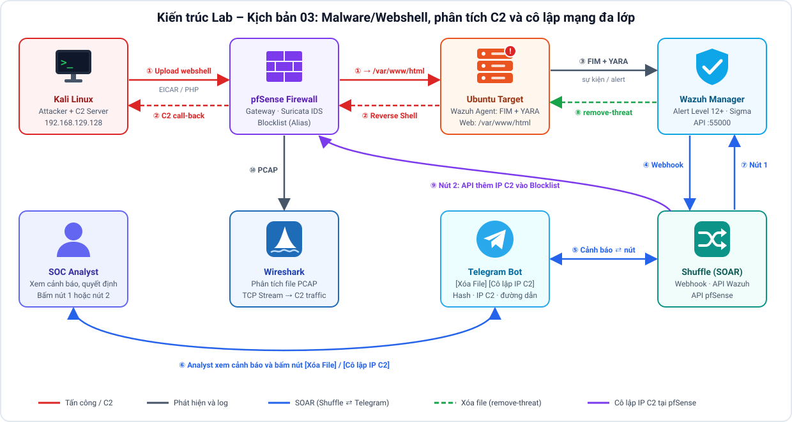
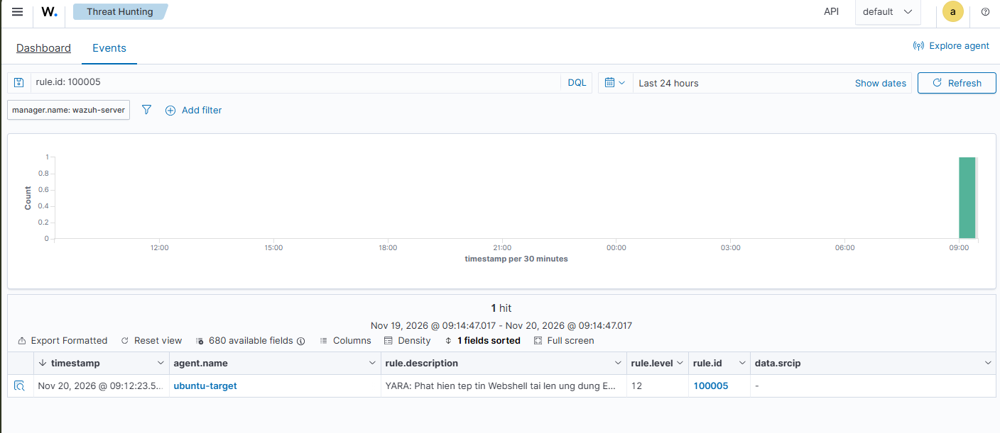
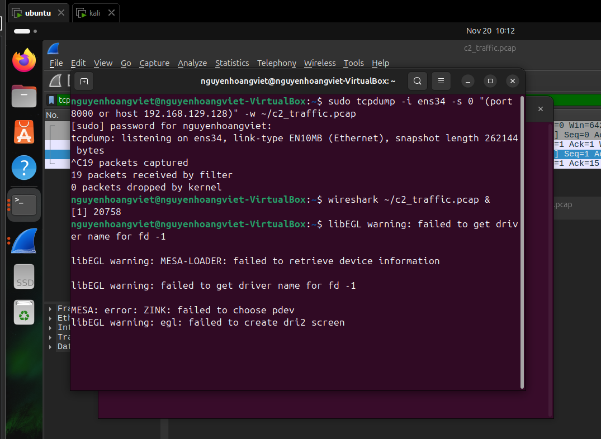
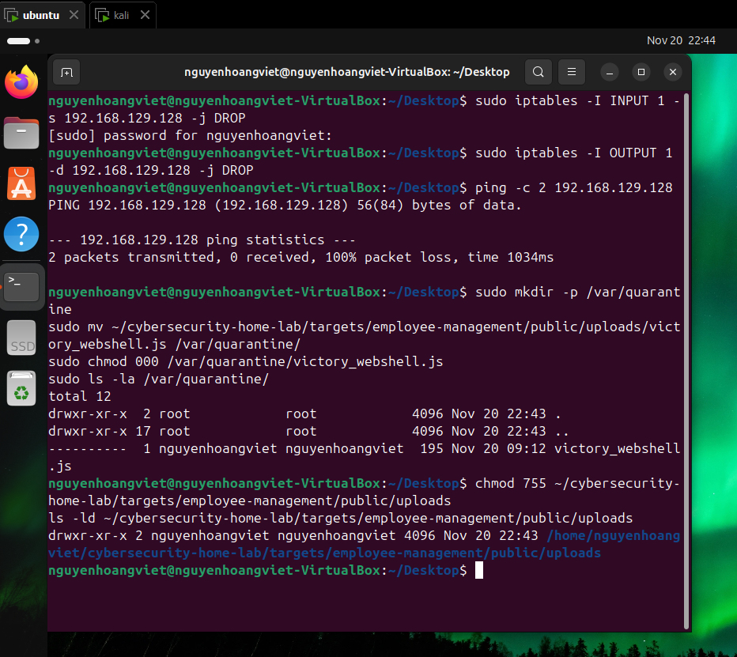

# Kịch bản 03: Phát hiện Mã độc (Webshell), Phân tích C2 và Cô lập Mạng Đa Lớp

## 1. Mục tiêu

Mô phỏng quy trình phát hiện và ứng phó sự cố (Incident Response) đa lớp từ Điểm cuối (Endpoint) đến Mạng (Network): kết hợp **Wazuh FIM + YARA** để phát hiện Webshell (`Rule 100005`, Level 12, `MITRE T1505.003`), dùng **`tcpdump`/Wireshark** truy vết lưu lượng C2 và thực thi cô lập hai chiều bằng **`iptables`**.

| Giai đoạn | Cơ chế | Mục tiêu chính |
|---|---|---|
| **Giai đoạn 1: Chuẩn bị** | Web App (`employee-management`) + Wazuh FIM | Tạo bề mặt tấn công thực tế và giám sát thời gian thực thư mục `public/uploads` |
| **Giai đoạn 2: Phát hiện** | Active Response + YARA + Custom Rule `100005` | Quét chữ ký mã độc ngay khi tệp mới xuất hiện và sinh cảnh báo Level 12 (`T1505.003`) |
| **Giai đoạn 3: Điều tra mạng** | `tcpdump` & Wireshark | Bắt gói tin Outbound, xác định IOC lớp mạng (IP/Port C2) và nội dung TCP Stream |
| **Giai đoạn 4: Ứng phó** | `iptables` + Quarantine + `chmod` | Cô lập mạng hai chiều, cách ly tệp mã độc và vá quyền thư mục |

---

## 2. Kiến trúc và môi trường Lab

<p align="center">
  
</p>

| Thành phần | Vai trò | Địa chỉ / Cấu hình |
|---|---|---|
| Kali Linux | Máy mô phỏng tấn công và máy chủ C2 | `192.168.129.128`, Listener port `4444` |
| Ubuntu Target | Ứng dụng web Node.js (`employee-management`) & Wazuh Agent | `192.168.129.129` (`ens34`), Web port `8000` |
| Wazuh Manager | Giải mã log YARA và kích hoạt Custom Rule `100005` | `192.168.129.131` |
| Công cụ phòng thủ | YARA, `tcpdump`, Wireshark, `iptables` | Triển khai trên Ubuntu Target |

**Luồng xử lý:** Tệp Webshell xuất hiện trong `public/uploads` → Wazuh FIM kích hoạt Rule `554` và gọi script `yara_scanner.sh` → YARA quét khớp chữ ký và ghi `active-responses.log` → Wazuh Manager giải mã và nổ Custom Rule `100005` (Level 12) → Analyst bắt gói tin Outbound bằng `tcpdump`/Wireshark để lấy IOC C2 → Cô lập mạng hai chiều bằng `iptables`, cách ly tệp vào `/var/quarantine` và siết quyền thư mục.

---

## 3. Cấu trúc thư mục

```text
03-webshell-c2-hunting/
├── README.md
├── diagrams/
│   └── architecture_03.svg
└── screenshots/
    ├── 01_ubuntu_yara_webshell_trigger.png
    ├── 01_yara_webshell_rule100005_overview.png
    ├── 02_yara_webshell_T1505_003_details.png
    ├── 03_ubuntu_tcpdump_c2_capture.png
    ├── 04_wireshark_c2_tcp_stream.png
    └── 05_ubuntu_containment_eradication.png
```

---

## 4. Giai đoạn 1 – Chuẩn bị môi trường và thiết lập FIM

Khởi chạy ứng dụng mục tiêu `employee-management` (port `8000`) trên Ubuntu Target, tạo thư mục `public/uploads` với quyền `777` để mô phỏng lỗ hổng cấu hình, sau đó bổ sung giám sát thời gian thực vào khối `<syscheck>` trong `/var/ossec/etc/ossec.conf`:

```xml
<directories realtime="yes" check_all="yes"><ĐƯỜNG_DẪN_TUYỆT_ĐỐI>/cybersecurity-home-lab/targets/employee-management/public/uploads</directories>
```

---

## 5. Giai đoạn 2 – Tích hợp YARA và xây dựng luật phát hiện

### 5.1. YARA Rule & Active Response Script (Ubuntu Target)

Tạo luật nhận diện các hàm thực thi lệnh nguy hiểm tại `/var/ossec/etc/rules/yara/webshell_detection.yar`:

```yara
rule Webshell_Detection {
    meta:
        description = "Phát hiện dấu hiệu Webshell (PHP/Node.js) qua các hàm rủi ro cao"
        author = "SOC Analyst"
        severity = "High"
    strings:
        $php1 = "eval("
        $php2 = "base64_decode("
        $php3 = "shell_exec("
        $php4 = "system("
        $node1 = "child_process.exec("
        $node2 = "Buffer.from("
    condition:
        any of them
}
```

Tạo script `/var/ossec/active-response/bin/yara_scanner.sh` để nhận đường dẫn tệp từ cảnh báo FIM, chạy YARA quét và ghi kết quả vào `/var/ossec/logs/active-responses.log`:

```bash
#!/bin/bash
read INPUT_JSON
FILENAME=$(echo $INPUT_JSON | jq -r .parameters.alert.syscheck.path)
YARA_PATH="/usr/bin/yara"
RULES_PATH="/var/ossec/etc/rules/yara/webshell_detection.yar"

if [ -f "$FILENAME" ]; then
    YARA_RESULT=$($YARA_PATH $RULES_PATH "$FILENAME")
    if [ -n "$YARA_RESULT" ]; then
        echo "wazuh-yara: Malware detected! Rule: $YARA_RESULT - File: $FILENAME" >> /var/ossec/logs/active-responses.log
    fi
fi
```

### 5.2. Custom Decoder & Rule `100005` (Wazuh Manager)

Khai báo Custom Decoder trong `/var/ossec/etc/decoders/local_decoder.xml` và Custom Rule `100005` trong `/var/ossec/etc/rules/local_rules.xml`, sau đó khởi động lại `wazuh-manager`:

```xml
<!-- local_decoder.xml -->
<decoder name="custom-yara-webshell">
  <prematch>wazuh-yara:</prematch>
</decoder>

<!-- local_rules.xml -->
<group name="local,syslog,yara,">
  <rule id="100005" level="12">
    <decoded_as>custom-yara-webshell</decoded_as>
    <match>Malware detected</match>
    <description>YARA: Phat hien tep tin Webshell tai len ung dung Employee Management.</description>
    <mitre>
      <id>T1505.003</id>
    </mitre>
  </rule>
</group>
```

### 5.3. Xác minh phát hiện Endpoint

1. **Log cục bộ trên Ubuntu Target:** Khi tệp `victory_webshell.js` được đưa vào `public/uploads`, YARA tự động quét trúng và ghi nhận vào `active-responses.log`.


2. **Cảnh báo trên Wazuh Dashboard:** Lọc theo `rule.id: 100005` tại **Threat Hunting → Events** hiển thị cảnh báo Level 12 cùng đầy đủ trường `decoder.name` (`custom-yara-webshell`), đường dẫn tệp và mã kỹ thuật `T1505.003` (Web Shell).




---

## 6. Giai đoạn 3 – Giám sát mạng và phân tích lưu lượng C2

1. **Ghi nhận gói tin bằng `tcpdump`:** Lắng nghe trên card mạng nội bộ `ens34` và xuất toàn bộ payload liên quan đến ứng dụng web (`8000`) và IP nghi vấn (`192.168.129.128`) ra file `.pcap`:

```bash
sudo tcpdump -i ens34 -s 0 "(port 8000 or host 192.168.129.128)" -w ~/c2_traffic.pcap
```



2. **Phân tích trên Wireshark (`Follow → TCP Stream`):**
   - **3-Way Handshake (Gói 13–15):** Xác nhận máy nạn nhân `192.168.129.129:48602` chủ động khởi tạo kết nối TCP chiều ra tới máy chủ C2 `192.168.129.128:4444`.
   - **Payload (Gói 18):** Thu giữ trực tiếp dữ liệu văn bản rõ (`whoami_output`) truyền qua kênh C2, xác lập đầy đủ **Network IOC** để cô lập.


---

## 7. Giai đoạn 4 – Cô lập mạng đa lớp, Cách ly mã độc và Vá cấu hình

Thực thi quy trình ứng phó **Containment → Eradication → Hardening** trên Ubuntu Target:

```bash
# 1. Cô lập mạng hai chiều (INPUT & OUTPUT) đối với IP C2
sudo iptables -I INPUT 1 -s 192.168.129.128 -j DROP
sudo iptables -I OUTPUT 1 -d 192.168.129.128 -j DROP

# 2. Cách ly tệp Webshell vào /var/quarantine và tước toàn bộ quyền
sudo mv ~/cybersecurity-home-lab/targets/employee-management/public/uploads/victory_webshell.js /var/quarantine/
sudo chmod 000 /var/quarantine/victory_webshell.js

# 3. Vá quyền thư mục public/uploads về mức an toàn
chmod 755 ~/cybersecurity-home-lab/targets/employee-management/public/uploads
```



---

## 8. Kết luận & Hướng phát triển

- **Hoàn thiện phòng thủ đa lớp (Defense in Depth):** Kết hợp phát hiện tệp độc hại tức thời (Wazuh FIM + YARA, `T1505.003`), điều tra lưu lượng C2 (`tcpdump`/Wireshark) và ứng phó triệt để (`iptables`, cách ly bằng chứng, vá quyền thư mục).
- **Hướng phát triển:** Kết nối Rule `100005` vào workflow SOAR (n8n/Shuffle) để gửi cảnh báo kèm mã Hash về Telegram, triển khai Suricata NIDS đẩy log `eve.json` về Wazuh, và tích hợp VirusTotal API để tự động làm giàu ngữ cảnh IOC.