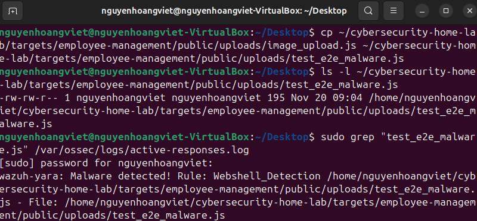
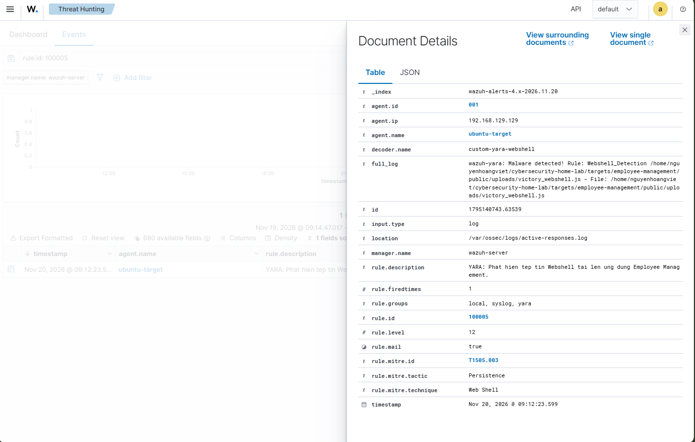
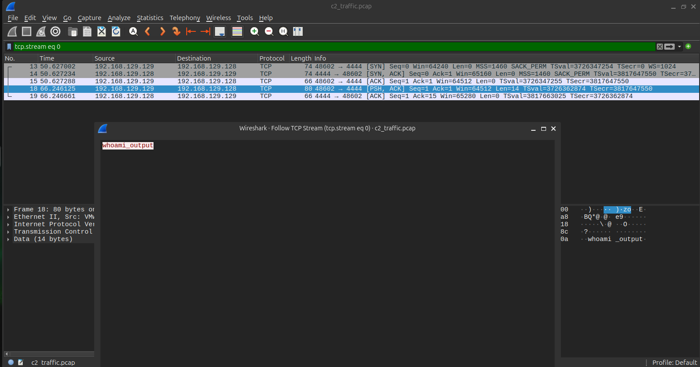

# Kịch bản 03: Phát hiện Webshell, Phân tích C2 và Cô lập Mạng

## 1. Mục tiêu

Mô phỏng ứng phó sự cố đa lớp từ Endpoint đến Network: **Wazuh FIM + YARA** phát hiện Webshell (`Rule 100005`, Level 12, `T1505.003`), **`tcpdump`/Wireshark** truy vết C2, **`iptables`** cô lập hai chiều.

| Giai đoạn | Cơ chế |
|---|---|
| 1. Chuẩn bị | Web App `employee-management` + FIM giám sát `public/uploads` |
| 2. Phát hiện | Active Response + YARA + Rule `100005` |
| 3. Điều tra mạng | `tcpdump` & Wireshark xác định IOC C2 |
| 4. Ứng phó | `iptables` + Quarantine + `chmod` |

## 2. Kiến trúc Lab

  

| Thành phần | Vai trò | Địa chỉ |
|---|---|---|
| Kali Linux | Tấn công / C2 (listener `4444`) | `192.168.129.128` |
| Ubuntu Target | Web Node.js (`8000`) + Wazuh Agent | `192.168.129.129` |
| Wazuh Manager | Giải mã log YARA, nổ Rule `100005` | `192.168.129.131` |

**Luồng xử lý:** Webshell xuất hiện trong `public/uploads` → FIM (Rule `554`) gọi `yara_scanner.sh` → YARA khớp chữ ký, ghi `active-responses.log` → Manager nổ Rule `100005` → Analyst bắt gói tin lấy IOC → cô lập bằng `iptables`, cách ly tệp vào `/var/quarantine`, siết quyền thư mục.

## 3. Kết quả chính

- **Phát hiện Endpoint:** YARA quét trúng `victory_webshell.js`; Wazuh hiển thị cảnh báo Level 12, `decoder: custom-yara-webshell`, `T1505.003`.

- **Điều tra mạng:** Wireshark xác nhận `192.168.129.129:48602` chủ động kết nối ra C2 `192.168.129.128:4444` và lộ dữ liệu cleartext (`whoami_output`).

- **Ứng phó:** Chặn IP C2 ở cả `INPUT` và `OUTPUT`, chuyển Webshell vào `/var/quarantine` (`chmod 000`), hạ quyền `uploads` từ `777` về `755`.

## 4. Kết luận & Hướng phát triển

Hoàn thiện phòng thủ đa lớp: phát hiện tức thời → điều tra C2 → ứng phó triệt để. Hướng phát triển: đưa Rule `100005` vào SOAR (n8n/Shuffle) gửi Hash về Telegram, thêm Suricata NIDS, tích hợp VirusTotal.

> Chi tiết YARA rule, script Active Response, decoder/rule XML, lệnh `tcpdump`: xem document dự án.
