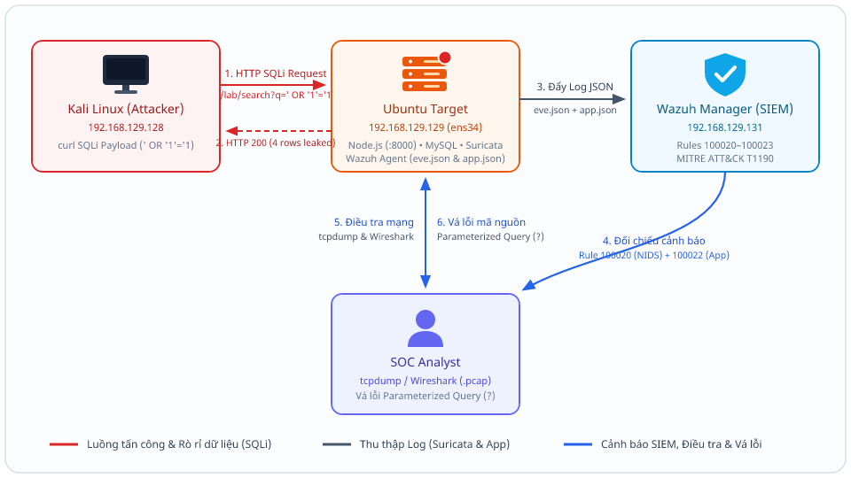
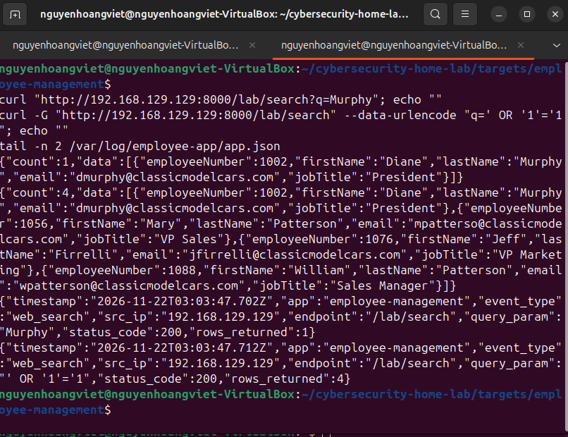
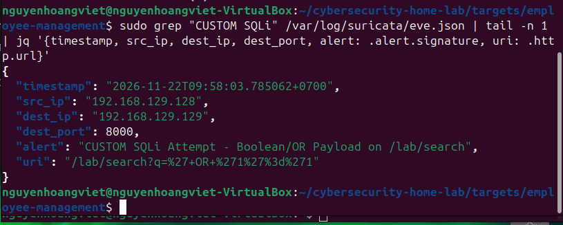
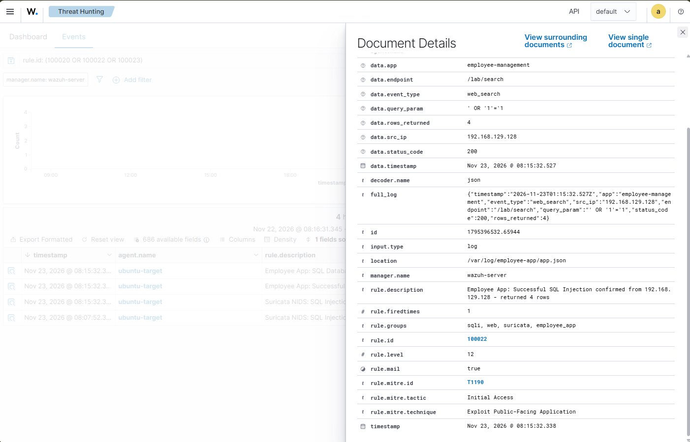
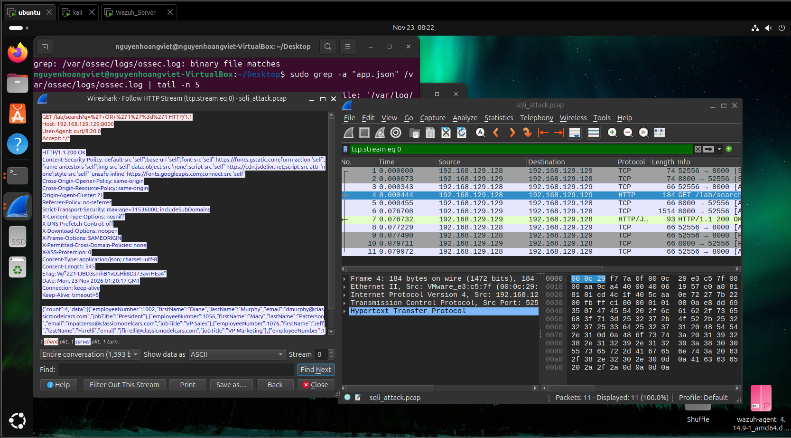
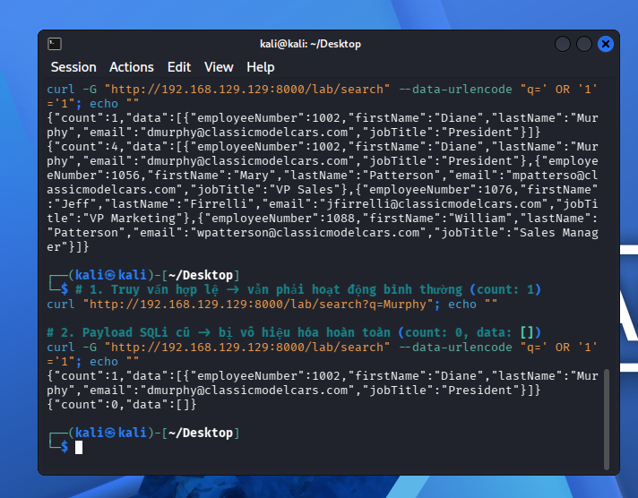

# Kịch bản 04: SQL Injection, Phát hiện bằng Suricata NIDS & Đối chiếu Application Log

## 1. Mục tiêu

Khai thác và phát hiện **SQL Injection (`T1190`)** trên `employee-management` bằng cách đối chiếu đa nguồn log: **Suricata NIDS** (nhận diện chữ ký trên mạng) và **Application JSON Log** (xác minh khai thác thành công hay không), tổng hợp về **Wazuh**, kiểm chứng bằng **Wireshark** và **vá lỗi trong mã nguồn**.

| Giai đoạn | Mục tiêu chính |
|---|---|
| 1. Tạo bề mặt tấn công | MySQL nội bộ, route `/lab/search` dính SQLi, ghi log `app.json` |
| 2. Khai thác & NIDS | Trích xuất bảng `employees`, Suricata bắt chữ ký (`SID 9000001`, `9000002`) |
| 3. SIEM & Forensics | Wazuh Rule `100020–100023`, Wireshark xác minh dữ liệu rò rỉ |
| 4. Vá lỗi | Parameterized Query, đối chiếu log xác nhận đã vô hiệu hóa |

## 2. Kiến trúc Lab

  

| Thành phần | Vai trò | Địa chỉ |
|---|---|---|
| Kali Linux | Gửi payload SQLi | `192.168.129.128` |
| Ubuntu Target | Web Node.js (`8000`), MySQL, Suricata, Wazuh Agent | `192.168.129.129` |
| Wazuh Manager | Tổng hợp `eve.json` + `app.json`, sinh cảnh báo `T1190` | `192.168.129.131` |

**Luồng xử lý:** Kali gửi payload → Suricata khớp chữ ký, ghi `eve.json` → ứng dụng ghi `app.json` (`query_param`, `status_code`, `rows_returned`) → Wazuh đối chiếu *Attempted* và *Successful* → Analyst kiểm chứng bằng Wireshark và vá lỗi.

> **Điểm cần lưu ý:** Log `app.json` bị Rule mặc định `86600` bắt trước nên Rule `100021` phải kế thừa `<if_sid>86600</if_sid>` để tách đúng luồng log ứng dụng.

## 3. Kết quả chính

- **Khai thác thành công:** Payload `' OR '1'='1` trả về toàn bộ 4 bản ghi (`rows_returned: 4`) thay vì 1.

- **NIDS:** Suricata ghi `eve.json` cảnh báo SQLi với `src_ip: 192.168.129.128`, `dest_port: 8000`.

- **SIEM:** Rule `100020` (NIDS, Level 10), `100022` (khai thác thành công, Level 12), `100023` (dò lỗi SQL, Level 8) nổ khớp thời điểm, cùng ánh xạ `T1190`.

- **Forensics:** Wireshark thu được request `GET /lab/search?q=%27+OR+%271%27%3d%271` và response `200 OK` chứa dữ liệu nhân viên cleartext.

- **Vá lỗi:** Chuyển sang Parameterized Query (`?`). Truy vấn hợp lệ vẫn trả `count: 1`, payload SQLi trả `count: 0` (`rows_returned: 0`).

## 4. Kết luận & Hướng phát triển

NIDS chỉ cho biết *nỗ lực* tấn công, còn Application Log mới phân biệt được *thành công* (`rows_returned: 4`) với *bị vô hiệu hóa* (`rows_returned: 0`). Parameterized Query khắc phục tận gốc mà không ảnh hưởng chức năng tìm kiếm. Hướng phát triển: Nginx + ModSecurity WAF, Active Response tự chặn IP khi Rule `100022` nổ.

> Chi tiết MySQL/`.env`, mã nguồn lỗ hổng, Suricata rules, XML rule Wazuh, lệnh `tcpdump`: xem document dự án.
